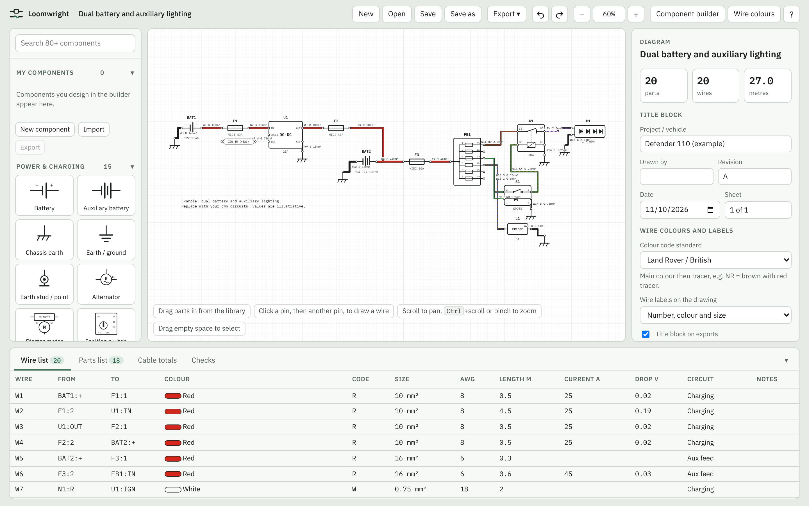

# LoomWright

Free, open-source wiring diagram software, mainly for vehicle builds, and also for household
wiring, workshop and factory control panels, and electronics projects.
Draw a loom the way you will build it: real components, real wire colours with tracers,
real cable sizes, and a wire list you can take to the bench.

LoomWright was started for a fully custom Land Rover Defender build, so it speaks 12 V
automotive: DIN relay terminals (30, 85, 86, 87, 87a), blade and MIDI fuses, fuse boxes,
split charge, winches, and Land Rover style colour codes such as `NR` (brown with red tracer).
It also draws household circuits, control panels and electronics projects, and plans
compressed air systems.



LoomWright is a planning and drawing tool. Its checks are guidance only and it does not replace a
qualified electrician or engineer: please read the [Disclaimer](#disclaimer).

## Quick start

1. **Get the app.** Download the installer for your computer from the Releases page
   (see [Getting the app](#getting-the-app)), or run it in a browser from the source with `npm run serve`.
2. **Look round the example.** The first time it starts, LoomWright opens an example project: the
   auxiliary electrics of a Land Rover Defender 110 on three sheets. Click a wire to see its details,
   or press <kbd>Alt</kbd> and click a wire to trace its circuit.
3. **Start your own.** Choose *File → New project*. Drag parts from the *Parts* pane onto the sheet,
   then click one pin and then another to draw a wire.
4. **Fill in the wires.** Select a wire and set its colour, size, length, circuit and harness in
   *Properties*. The *Wire list* at the bottom fills in as you go.
5. **Save** with <kbd>Ctrl</kbd>+<kbd>S</kbd>. Projects are `.loom` files.
6. **Get help.** The user manual is built in: press <kbd>F1</kbd> or use the *Help* menu.

## Documentation

- **[User manual](docs/manual/01-getting-started.md)**: every feature, step by step. The same manual
  is built into the app.
- **[Documentation index](docs/README.md)**: the manual's chapters and the guides below.
- [Disclaimer](docs/manual/28-disclaimer.md): what LoomWright can and cannot tell you.
- [The Claude add-on](docs/claude-addon.md): setting up the optional add-on.
- [Building LoomWright](docs/building.md): running from the source, tests, the desktop app and releases.
- [The .loom file format](docs/file-format.md) and [Components](docs/components.md): for reading
  and writing projects and symbols from other programs.
- [Contributing](CONTRIBUTING.md).

## Features

- **129 built-in components** across power and charging, protection, switches, relays,
  lighting, motors and loads, gauges and sensors, connectors, electronics, household wiring
  and control panels, plus starter circuits that drop in ready drawn.
  Parametric parts (fuse boxes, connectors, busbars, terminal strips, modules, ICs) take any number of pins.
- **Real connectors.** Deutsch DT/DTM/DTP, Superseal, Econoseal, Metri-Pack, Lucar, bullets and Anderson,
  with ways, plug or receptacle side, housing and wedge-lock part numbers, terminals and cavity plugs.
  Mated pairs join cavity for cavity. Connector tables list every cavity.
- **Component builder.** Draw your own symbol with lines, boxes, circles and text, place pins,
  add fields such as `rating = 15A`, and save it to *My components*. Start from any library symbol.
  Export and import your component library to share it.
- **Wire colours your way.** Land Rover / British (B, U, N, R, G…), DIN 72551 / IEC 60757 (BK, BU, BN…)
  or SAE (BLK, BLU, BRN…) codes, a main colour plus up to two tracers, and fully custom colours
  with your own names, codes and shades for a non-standard loom.
- **Projects and sheets.** A project holds as many sheets as you need (charging, lighting, dash,
  trailer…). Sheet tabs, a project pane, off-sheet references between sheets, wire numbers that stay
  unique across the project, and a title block that says *Sheet 2 of 5*.
- **Colour reuse for limited stock.** Tick the cable colours you actually have and LoomWright offers
  only those. Give each wire a circuit and a harness; the *Colour usage* list shows every job a colour
  does, and flags the same colour used for different circuits inside one harness.
- **Wiring.** Click pin to pin. Square-cornered routing, draggable runs, bend points, straight lines.
- **Wire data.** Number, circuit, harness, size in mm² (with AWG), length, current, insulation, multicore
  cable, notes, and how each end is finished: terminal, crimp or solder, strip length, heat-shrink, seal.
- **Revision history.** Issue revisions A, B, C… with a description, compare any two (or a revision and
  the drawing now), go back to one, and draw revision clouds round what changed. A revision table sits
  above the title block, and local save points keep a rolling history of your work.
- **Proper sheets.** A4 to A1, landscape or portrait, with a frame, zone grid, and cross-references that
  say which sheet and zone an off-sheet link continues on. Black-and-white mode writes the colour codes.
- **Trace and test.** Click a wire to light up the whole circuit across sheets. The live test flicks
  switches and blows fuses to show what runs, with the volts and amps at each load worked out from
  wire sizes and lengths.
- **Fault finding.** A step-by-step test sheet for a load that does not work, will not switch off,
  keeps blowing its fuse, or is dim, with the readings to expect at each point.
- **Design checks.** Fuse rating against cable size, current, voltage drop over 3 %, unconnected pins,
  duplicate references, loads with no fuse or no earth, supplies shorted to earth, terminals that do not
  suit the wire, mixed colours on one net.
- **Fuses and loads.** A fuse and relay schedule and load budget for every fuse way, relay, battery,
  alternator and DC-DC charger.
- **Build outputs.** Cut lists per harness, connector tables, costed parts list, cable to buy, wire labels
  for a label printer or A4 label sheets, and a printable build pack with all of it.
- **Harness formboard.** Lay out each harness as branches with lengths and sleeving, see bundle sizes,
  export it 1:1 as DXF, and copy the routed lengths back onto the wires.
- **Component locations** on a photo or outline of the vehicle.
- **Stock and build progress.** Keep a list of the cable and parts you have, get a shopping list
  of what to buy, and tick off each wire as it is cut, terminated, fitted and tested, also from a phone.
- **Household wiring (UK).** Consumer units, sockets, lights, showers, cookers, EV chargers and solar,
  with a circuit schedule and guidance checks drawn from selected BS 7671 rules: cable rating, rings,
  RCDs, earth loop impedance, voltage drop and maximum demand. Guidance only: see the
  [Disclaimer](#disclaimer).
- **Factory and control panels.** Isolators, motor breakers, contactors, overloads, motors, e-stops,
  PLC cards and drives, with guidance checks from selected BS EN 60204-1 recommendations, motor,
  terminal and PLC I/O lists, and wire numbering by potential.
- **Loads library.** Machines, household appliances and solar parts with typical ratings.
- **Compressed air planner.** Plan a workshop or garage air system: compressor, receiver, air
  treatment, pipe runs, drops and tools. It estimates demand, pipe pressure drop and air speed,
  pressure at each tool, receiver size, running and leak costs and water to drain, with plain-English
  checks. Planning estimates only: see the [Disclaimer](#disclaimer).
- **Import and export.** SVG, PNG, DXF, PDF with bookmarks and clickable cross-references, CSV for every list, WireViz YAML both ways, KiCad netlists,
  spreadsheet wire lists, measured lengths, and a read-only web page anyone can open.
- **Comforts.** Several projects open in tabs, reusable circuit blocks, align and distribute with guide
  lines, find and replace, renumbering, and the interface in English, German, French, Spanish or Dutch
  (translations are a first pass).
- **Desktop app** for Windows and Apple Silicon Macs (and Linux), fully offline, built with Tauri.
  A portable Windows copy runs from a folder or USB stick.
- **Optional Claude add-on.** An MCP server that lets Claude draw and edit projects from a
  plain-English description, turn a picture of a component's pinout into a custom component
  in your library, issue and compare revisions, trace, test and solve circuits, write fault-finding
  sheets, plan compressed air systems, and produce the build lists.
  See [docs/claude-addon.md](docs/claude-addon.md).

Projects are saved as `.loom` files, which are plain JSON, so they work well with Git.

## Getting the app

Installers are built by GitHub Actions (see *Desktop builds* under the Actions tab, or the Releases page):

| Computer | Download |
| --- | --- |
| Windows 10/11 | `.msi` or `-setup.exe`, or `-portable.zip` to run without installing |
| Mac with Apple Silicon (M1 and later) | `.dmg` |
| Linux | `.AppImage` or `.deb` |

The portable zip holds `LoomWright.exe` and an empty file called `portable`. While that file is there,
LoomWright keeps its settings, autosave and *My components* in a `LoomWright-data` folder beside the
program. It needs the Microsoft Edge WebView2 runtime, which Windows 10 and 11 already have.

The builds are not code-signed yet. On Windows choose *More info → Run anyway*. On a Mac,
right-click the app and choose *Open* the first time.

You can also run the editor without installing anything: open `app/index.html` in a browser,
or run `npm run serve` and visit http://localhost:5173.

## Building from source

You need [Node.js](https://nodejs.org) 18+ and [Rust](https://rustup.rs), plus the
[Tauri prerequisites](https://tauri.app/start/prerequisites/) for your system.

```sh
npm install
npm run dev      # run the desktop app with live reload
npm run build    # build an installer for this computer
npm test         # check the component library and example
npm run manual   # rebuild the in-app manual after editing docs/manual
```

To build the Windows and Mac installers in the cloud, push a tag like `v0.4.0` or run the
*Desktop builds* workflow by hand. The installers land on a draft release.
[docs/building.md](docs/building.md) has the details.

## Project layout

| Path | What it is |
| --- | --- |
| `app/` | The editor (plain HTML, CSS and JavaScript, no build step) |
| `app/core/loom-core.js` | Component library, colour standards, project model, renderer, checks and revisions |
| `app/core/loom-data.js` | Connector series, terminals, insulation, sleeving and how each part behaves electrically |
| `app/core/loom-nets.js` | Nets, circuit trace, live test, fuse and load schedule, project checks |
| `app/core/loom-reports.js` | Cut lists, connector tables, labels, costed parts list, formboards, build pack, CSV tables |
| `app/core/loom-io.js` | Import and export: CSV wire lists, WireViz, KiCad, DXF, read-only web page |
| `app/core/loom-air.js` | Compressed air planning: demand, pipe pressure drop, receiver size, costs and checks |
| `app/core/loom.js` | Loads all of the core in Node, for the Claude add-on and the tests |
| `app/editor.js`, `app/views.js` | The editor, and the formboard and vehicle views |
| `app/air-view.js` | The compressed air planner |
| `app/i18n.js` | Interface languages |
| `app/builder.js` | Component builder |
| `app/manual-viewer.js`, `app/manual.css` | The built-in user manual viewer |
| `app/manual.js` | The user manual, built from `docs/manual/` by `scripts/build-manual.js` (do not edit by hand) |
| `src-tauri/` | Desktop app shell (Rust, Tauri 2): native open/save dialogs and live reload of edited files |
| `mcp/` | Optional Claude add-on (MCP server) |
| `docs/` | The user manual (`docs/manual/`) and guides |

## Contributing

Issues and pull requests are welcome, especially new component symbols and corrections to the
translations. A built-in component is a short entry in `app/core/loom-core.js` (or `loom-data.js`
for connector-type parts): a name, category, size (multiples of 20), pins (on a 10-unit grid) and a
list of shapes; see [docs/components.md](docs/components.md). Run `npm test` before sending a change.
[CONTRIBUTING.md](CONTRIBUTING.md) has the rest.

## Disclaimer

LoomWright is a basic tool for planning and drawing wiring.

- Its design checks, load figures, wire size guide figures and other hints are **guidance only**. They are rules
  of thumb and do not show that a design or an installation meets BS 7671, IEC 60204, the Building
  Regulations or any other standard, regulation or code. The wire size figures assume single PVC
  automotive cable. Check wire sizes, fuse ratings and part numbers against the cable, fuse and
  component makers' data.
- It does **not replace a qualified electrician or engineer**.
- Work on **mains electricity or compressed air** systems must be designed, installed, inspected and
  tested by a competent person.
- LoomWright is free software under the GPL and comes with **no warranty**, as far as the law allows.
  The authors and contributors accept no responsibility for any loss, damage, injury or death arising
  from its use.

## Licence

LoomWright is free software: you can redistribute it and/or modify it under the terms of the
GNU General Public License version 3, or (at your option) any later version. See [LICENSE](LICENSE).

The bundled IBM Plex fonts are under the SIL Open Font License (`app/fonts/OFL.txt`).
The bundled js-yaml (`app/vendor/js-yaml.min.js`, used for WireViz files) is under the MIT License (`app/vendor/js-yaml.LICENSE`).
