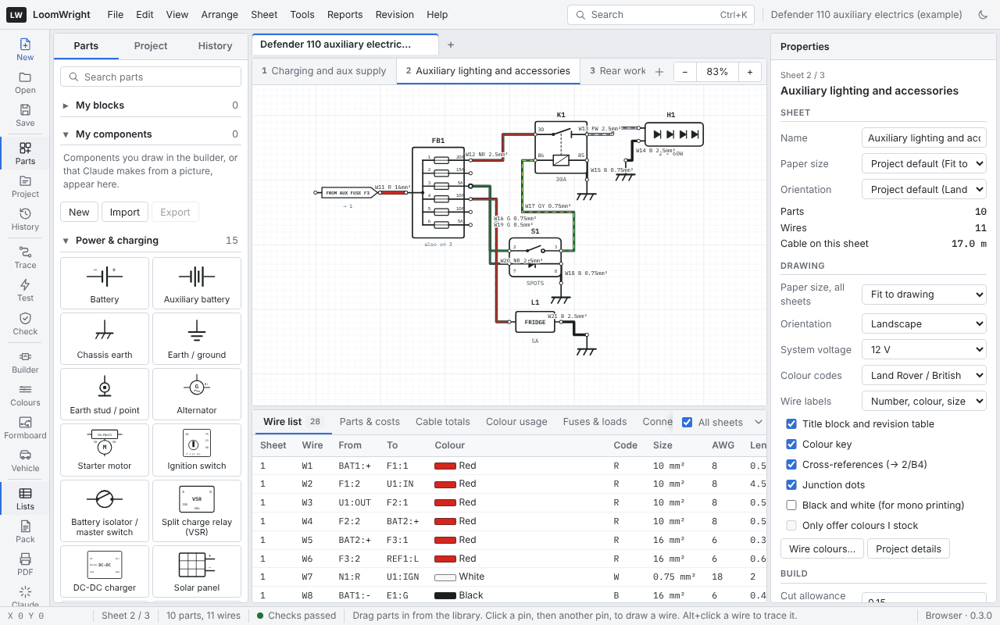

# The window

This chapter names the parts of the LoomWright window, so the rest of the manual can refer to them.

## Title bar and menus

Along the top of the window:

- **Menus**: File, Edit, View, Arrange, Sheet, Tools, Reports, Revision and Help. Every command in LoomWright is in one of these menus. Menu items show their keyboard shortcut on the right. A few commands only appear when the project needs them: for example, **Reports › Circuit schedule (household)** appears in household projects, and **Tools › Number wires by potential…** in factory projects.
- **Search** (<kbd>Ctrl</kbd>+<kbd>K</kbd>): see [Search everything](#search-everything) below.
- **The project name**, followed by the file name once the project has been saved. A dot (•) after the name means there are changes not yet saved to the file.
- **The moon button** switches between the light and dark themes. The drawing sheet stays white in both, so wire colours look the same.

## Search everything

Press <kbd>Ctrl</kbd>+<kbd>K</kbd>, or click **Search** in the title bar, and start typing. The list finds:

- commands from every menu, with their shortcuts,
- the sheets in the project,
- the other projects you have open,
- parts already placed, by reference (for example `K1`) or name,
- wires, by wire number,
- components in the library, to place a new one.

Use <kbd>↑</kbd> and <kbd>↓</kbd> to move through the list, <kbd>Enter</kbd> to choose, and <kbd>Esc</kbd> to close it. Choosing a placed part or a wire goes to its sheet and selects it.

## The tool rail

The narrow column of buttons on the far left gives one-click access to the commands you use most:

| Button | What it does |
| --- | --- |
| New, Open, Save | Start a new project, open a `.loom` file, save the project. |
| Parts, Project, History | Show or hide the left-hand pane on that tab. |
| Trace | Trace the circuit of the selected wire. See [Circuit trace and live test](11-trace-and-live-test.md). |
| Test | Start or stop the live circuit test. |
| Check | Show the design checks. See [Design checks](10-design-checks.md). |
| Builder | Open the component builder. |
| Colours | Open **Wire colours and stock**. |
| Formboard | Open the harness formboard. |
| Vehicle | Open the component locations view. |
| Lists | Show or hide the Lists pane under the sheet. |
| Pack | Make a build pack to print or save as PDF. See [Build pack and wire labels](15-build-pack-and-labels.md). |
| PDF | Export the drawings and lists as one PDF with bookmarks and links. See [Export PDF](15-build-pack-and-labels.md#export-pdf). |
| Claude | How to use the optional Claude add-on. |

## The left pane

The left pane has three tabs. Click the same tool rail button again to hide the pane and give the drawing more room.

- **Parts** is the component library, with a search box at the top. Parts are grouped by category; click a heading to fold it away. **My blocks** and **My components** at the top hold the circuits and symbols you have saved yourself. See [Drawing](03-drawing.md#placing-parts).
- **Project** holds the project details (title, vehicle, drawn by, revision, date), the list of sheets, the harnesses, the multicore cables and the totals for the whole project. See [Projects and sheets](05-projects-and-sheets.md).
- **History** holds issued revisions and the save points kept on this computer. See [Revision history and save points](20-revisions-and-save-points.md).

## Project tabs and sheet tabs

Above the drawing are two rows of tabs.

- **Project tabs** (the top row) show each open project. Click a tab to switch to it. The **×** on a tab closes that project; if it has unsaved changes, LoomWright asks first. The **+** at the end starts a new project.
- **Sheet tabs** (the second row) show the sheets of the current project, numbered in order. Click a tab to show that sheet, double-click it to rename it, and use the **+** to add a sheet. <kbd>PgDn</kbd> and <kbd>PgUp</kbd> step through the sheets.

At the right-hand end of the sheet tabs are the zoom buttons. The figure between **−** and **+** is the zoom level; click it to fit the whole sheet in the window.

## The drawing area

The middle of the window is the sheet you are drawing on. The sheet is always white with black lettering, whichever theme you use, because that is how it prints.

How to move around:

- Scroll to move up and down; hold <kbd>Shift</kbd> while scrolling to move sideways. A trackpad scrolls in both directions.
- Hold <kbd>Ctrl</kbd> and scroll (or pinch on a trackpad) to zoom in and out around the pointer. Zoom runs from 10% to 500%.
- Hold <kbd>Space</kbd> and drag, or drag with the middle mouse button, to pan.
- Press <kbd>0</kbd> to fit the sheet to the window.

## The Properties pane

The pane on the right shows the details of whatever is selected, and is where you change them:

- **Nothing selected**: settings for the sheet and for the whole drawing (project type, paper size, colour codes, wire labels, title block and so on). See [Projects and sheets](05-projects-and-sheets.md#sheet-and-drawing-settings).
- **A part**: its reference, its fields, its part data and a list of its pins with the wires on each.
- **A wire**: its number, circuit, harness, colours, size, length, current, insulation, how each end is finished and its build progress. See [Wires and colours](04-wires-and-colours.md).
- **Several things**: buttons to rotate, duplicate, align or delete them together, and fields to set the colour, size, circuit, harness or insulation of every selected wire at once.

**View › Properties** hides or shows this pane.

## The Lists pane

Under the sheet is the Lists pane, with a tab for each list LoomWright keeps up to date as you draw: **Wire list**, **Parts & costs**, **Cable totals**, **Colour usage**, **Fuses & loads**, **Connectors**, **Cut list**, **Build**, **Shopping**, **Circuits** and **Checks**. The number on a tab is a count, for example how many wires there are.

A few more tabs appear when the project needs them: **Circuit schedule** in household projects, **Motors** and **PLC I/O** in factory projects, and **Terminal plan** in factory projects or once you place a terminal strip.

- **All sheets** shows the whole project; untick it to list only the sheet you are looking at.
- Click a row to select that wire or part on the drawing, going to its sheet if need be.
- The arrow at the right-hand end folds the pane away. The **Lists** tool rail button brings it back.

[Lists and reports](14-lists-and-reports.md) describes each list.

## The status bar

The bar along the bottom of the window shows, from left to right:

- the pointer position on the sheet, in drawing units, and the zone (such as `B4`) when the sheet has a frame,
- which sheet you are on, out of how many, and its paper size,
- how many parts and wires are on this sheet,
- the design checks: **Checks passed**, or how many need a look. Click it to open the **Checks** list,
- a hint for what you are doing now, such as how to finish a wire,
- where LoomWright is running (Desktop or Browser) and its version. During the live test this starts with **LIVE TEST**.

## Narrow windows

LoomWright works in a window as narrow as 900 pixels. On a smaller screen the panes get narrower. In a browser window narrower than that, the panes stack above and below the drawing instead of beside it.
