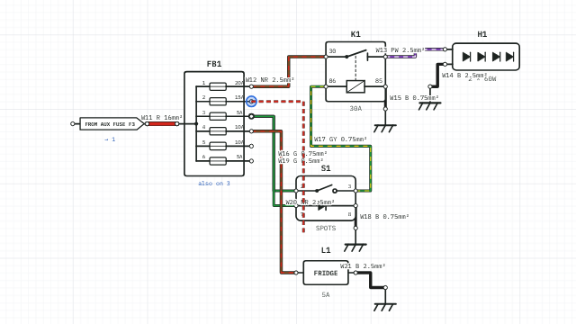

# Drawing

This chapter covers putting parts on a sheet, wiring them together, and arranging the drawing so it is easy to read.

LoomWright draws on a grid of 10 drawing units. Parts and bend points snap to it, so wires line up. On a printed sheet, 4 drawing units are 1 mm.

## Placing parts

The **Parts** pane on the left holds the component library: batteries, fuses, fuse boxes, switches, relays, lamps, motors, gauges, connectors and electronic parts, grouped by category. Household and factory parts have their own categories.

The order of the categories, and which ones start open, follow the **Project type**. In a household project, **Household**, **Loads library** and **Wiring & connectors** come first and the vehicle categories are folded away. In a vehicle project, the mains categories are folded away. A **Mixed** project opens everything. See [Projects and sheets](05-projects-and-sheets.md#project-type).

To place a part:

- **Drag it** from the list onto the sheet, or
- **Click it** in the list to drop it in the middle of the view.

Type in **Search parts** to narrow the list. The search looks at the part's name, category and reference letter, so `relay`, `fuse` or `K` all work. You can also place a part from the <kbd>Ctrl</kbd>+<kbd>K</kbd> search.

Each new part gets a **reference**: a letter for the kind of part and the next free number, such as `F1`, `F2` for fuses, `K1` for relays, `S1` for switches and `H1` for lamps. Change it in the Properties pane if you prefer your own scheme. **Edit › Renumber wires and parts** tidies the numbers later; see [Renumbering](#renumbering-wires-and-parts).

Some parts change shape with their fields: a fuse box draws as many ways as you give it, and connectors, busbars, terminal strips, modules and ICs take any number of pins.

## Editing a part

Click a part to select it. The Properties pane then shows:

- **Reference**, and the part's own fields, such as a fuse rating, a relay's contact rating, a lamp's wattage or a switch legend. Most fields are written under the symbol on the drawing.
- **Part data**: part number, supplier, unit cost and where it is fitted. See [Part data](08-part-data.md).
- **Rotate**, **Flip**, **Duplicate** and **Delete** buttons.
- **Pins**: every pin with its name, the wire on it and where that wire goes. A pin with nothing on it says **free**. The **⤳** button beside a pin traces the circuit from that pin.

Double-click a part on the sheet to jump straight to its first field.

## Selecting

- **Click** a part or wire to select it.
- **Shift+click** adds a part or wire to the selection, or takes it out again.
- **Drag across empty space** to draw a selection box. It selects the parts that are wholly inside the box and the wires that run between them. Hold <kbd>Shift</kbd> while dragging to add to what is already selected.
- <kbd>Ctrl</kbd>+<kbd>A</kbd> selects everything on the sheet.
- <kbd>Esc</kbd> clears the selection.

## Moving, rotating and flipping

- **Drag** a selected part, or several, to move them. Wires follow.
- The **arrow keys** move the selection 10 units; with <kbd>Shift</kbd>, 50 units.
- <kbd>R</kbd> rotates the selection a quarter turn clockwise; <kbd>Shift</kbd>+<kbd>R</kbd> turns it the other way.
- <kbd>F</kbd> flips the selection left to right.

If you press on a pin and drag, LoomWright moves the part instead of starting a wire.

## Drawing wires

To draw a wire, **click a pin, then click another pin**. Point at a pin first: the pointer turns into a cross and a blue circle marks the pin.

While you are drawing:

- **Click empty space** to add a bend point on the way.
- **Click the starting pin again**, or press <kbd>Esc</kbd>, to give up.

Things to know about new wires:

- A new wire takes the colour, tracer, size and harness of the last wire you changed, so a run of similar wires is quick to draw.
- Wires are numbered `W1`, `W2` and so on. The numbers are unique across the whole project, not only the sheet.
- A pin can carry several wires. Where two or more wires meet at a pin, LoomWright draws a junction dot (**View › Junction dots** turns them off).
- To join wires part-way along, place a **Splice / junction** part from **Wiring & connectors** and wire to it.

## Shaping wire routes

By default a wire is drawn with square corners: across, down, and across again. When you select such a wire, a small square handle sits on its middle run. **Drag the handle** sideways to move that run.

For more control, add bend points:

- **Double-click a wire** to add a bend point where you clicked.
- **Drag a bend point** to move it. Bend points show as small squares when the wire is selected.
- **Double-click a bend point** to remove it.
- **Clear bends** in the wire's Properties puts it back to the automatic route.

Under **Cable** in the wire's Properties, **Routing** chooses **Square corners** or **Straight lines**. Straight lines run directly from point to point, which suits a block diagram or a quick sketch.

## Tidying wires

**Arrange › Tidy wires** (<kbd>Shift</kbd>+<kbd>T</kbd>) lays wires out again with square corners. Each tidied wire goes around the parts, with as few bends as it can, and keeps clear of running along other wires.

What it tidies:

- the selected wires, or
- if no wires are selected, every wire on the selected parts, or
- if nothing is selected, every wire on the sheet.

It works on the sheet you are looking at. Wires set to **Straight lines** are left alone. So is a wire with no clear way through; the message after tidying says how many wires it changed. The new route is ordinary bend points, so you can drag them afterwards.

Tidying cannot be done during the live test. To put the wires back, press <kbd>Ctrl</kbd>+<kbd>Z</kbd>, or click **Undo** in the message.

## Wire labels

Each wire carries a label. What it shows is set for the whole drawing under **Wire labels** (with nothing selected): **Number, colour, size**, **Colour code only**, or **None**.

- **Drag a label** to move it somewhere clearer. A thin leader line points back to its wire.
- **Double-click a moved label** to put it back in its usual place.

## Copy, paste and duplicate

- <kbd>Ctrl</kbd>+<kbd>C</kbd> copies the selected parts and the wires between them. <kbd>Ctrl</kbd>+<kbd>X</kbd> cuts them.
- <kbd>Ctrl</kbd>+<kbd>V</kbd> pastes them, a little below and to the right. You can paste onto another sheet, or into another open project.
- <kbd>Ctrl</kbd>+<kbd>D</kbd> duplicates the selection in one step.

Pasted parts get new references and pasted wires get new numbers, so nothing clashes. A wire is only copied if both of its ends are on copied parts.

## Deleting and undoing

- <kbd>Delete</kbd> (or <kbd>Backspace</kbd>) deletes the selection. Deleting a part also deletes the wires on it.
- <kbd>Ctrl</kbd>+<kbd>Z</kbd> undoes, and <kbd>Ctrl</kbd>+<kbd>Shift</kbd>+<kbd>Z</kbd> (or <kbd>Ctrl</kbd>+<kbd>Y</kbd>) redoes. LoomWright keeps the last 200 steps for each open project.

## Aligning and spacing parts

While you drag parts, pink dashed **guide lines** appear when an edge or the centre of what you are moving lines up with another part on the sheet. Let go on a guide line and the parts are in line.

To line up several parts at once, select them and use the **Arrange** menu, or the **Arrange** buttons in the Properties pane:

- **Align left**, **Align centres**, **Align right** line parts up on a vertical line.
- **Align tops**, **Align middles**, **Align bottoms** line them up on a horizontal line.
- **Distribute across** and **Distribute down** space three or more parts evenly between the outermost two. In the Properties pane these are called **Space evenly across** and **Space evenly down**.

## Starter circuits

**Starter circuits** at the top of the Parts pane are ready-made circuits to place and change. The ones shown follow the project type:

| Project type | Starter circuits |
| --- | --- |
| Vehicle | Spot lamps with relay, Split charge with VSR, Split charge with DC-DC charger, Winch with isolator, Air compressor with pressure switch, Reversing camera and monitor. |
| Household | Consumer unit with RCBOs. See [Household wiring](18-household-wiring.md#the-starter-consumer-unit). |
| Factory, workshop and control panels | Motor starter, direct on line. See [Factory, workshop and control panels](19-factory-and-control-panels.md#the-direct-on-line-starter). |
| Mixed | All of them. |

The section starts folded. Click its heading to open it. Hold the pointer over a starter circuit to read what it holds. Typing in **Search parts** finds starter circuits of every type.

To place one, drag it onto the sheet, or click it to drop it in the middle of the view. Its parts get fresh references and its wires get fresh numbers. A coil and its contacts that share a reference in the starter circuit still share one new reference. The wires are tidied around the parts where they land.

The sizes, ratings and lengths in a starter circuit are typical starting points, not a design. Change them to suit your own parts and runs.

## Blocks: reusable circuits

A block is a piece of circuit you use again and again, such as a relay-switched lamp with its fuse and switch.

To make one, select the parts and the wires between them, then choose **Edit › Save selection as block** (or **Save as block** in the Properties pane). Give it a name. It appears in the Parts pane under **My blocks**.

To use it, drag it onto a sheet or click it. Its parts arrive with fresh references and fresh wire numbers. To delete a block from the library, click the **✕** on it in **My blocks**; the message that follows offers **Undo**.

Blocks are kept in your library on this computer, with **My components**, not in the project. To move them to another computer, see [Sharing components and blocks](09-component-builder.md#sharing-components-and-blocks).

## Finding and replacing

**Edit › Find** (<kbd>Ctrl</kbd>+<kbd>F</kbd>) searches wire numbers, circuits, harnesses, wire notes, part references, part values and text, locations and part numbers. Tick or untick each kind to narrow the search, and choose **All sheets**, **Match case** or **Whole words** as needed. Click a result to go to it.

**Edit › Find and replace** (<kbd>Ctrl</kbd>+<kbd>H</kbd>) does the same, then changes every match with **Replace all**. It is useful for renaming a circuit or a harness throughout the project. **Replace all** can be undone with <kbd>Ctrl</kbd>+<kbd>Z</kbd>.

## Renumbering wires and parts

After a lot of editing, wire numbers and references end up out of order. **Edit › Renumber wires and parts** numbers them again in drawing order: sheet by sheet, then top to bottom and left to right.

- For wires, choose a **Prefix** (such as `W`), the number to **Start at** and the **Step**. **Start each sheet at the next hundred** gives sheet 1 wires 101, 102…, sheet 2 wires 201, 202…, and so on.
- **Part references** renumbers F1, F2, K1… as well.
- **All sheets**, or only the sheet you are on.

A part drawn on several sheets keeps one reference, and connectors keep pointing at the connector they mate with. Renumbering can be undone.

Control panel drawings often number wires by potential instead. See [Numbering wires by potential](19-factory-and-control-panels.md#numbering-wires-by-potential).

> Renumbering changes the numbers on any labels you have already printed. Do it before you print labels, not after.
