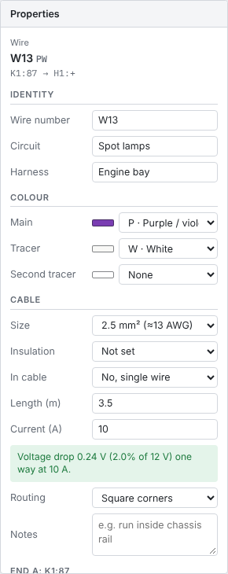
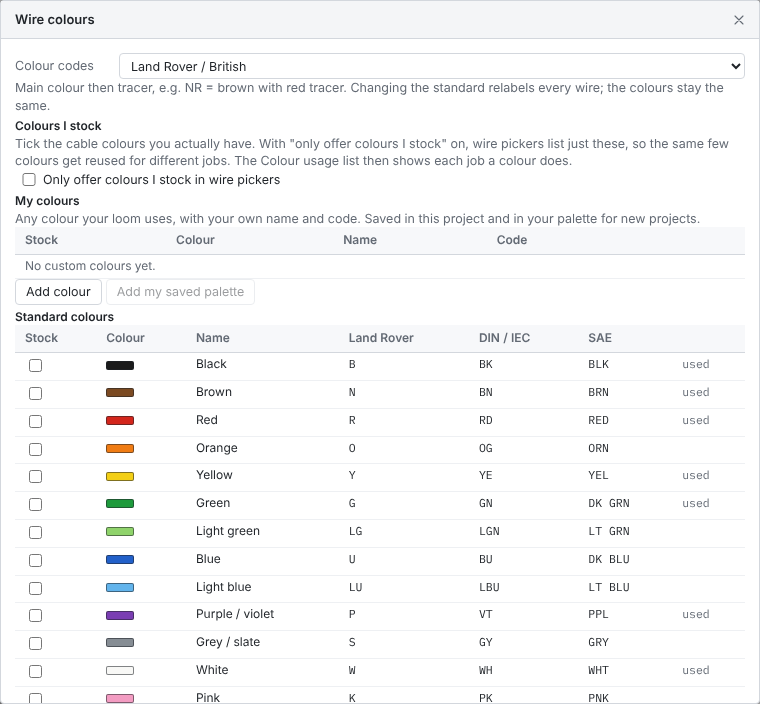

# Wires and colours

Every wire in LoomWright carries the information you need to make it: a number, the circuit it belongs to, the harness it runs in, its colours, its size, its length and how each end is finished. This chapter covers all of it except the ends, which have their own chapter, [Harnesses, connectors and wire ends](07-harnesses-connectors-and-ends.md).

## The wire's properties

Click a wire to select it. The Properties pane shows the wire number and code at the top, where it runs from and to, and these sections:

- **Identity**: wire number, circuit and harness.
- **Colour**: main colour, tracer and second tracer.
- **Cable**: size, insulation, multicore cable, length, current, routing and notes.
- **Installation (mains guide)**: only in household, factory and mixed projects. How a mains cable is run. See [Cables and how they are run](18-household-wiring.md#cables-and-how-they-are-run).
- **End A** and **End B**: terminal, fitting, strip length, seal and heat shrink for each end.
- **Build and test**: whether the wire is cut, its ends are done, it is fitted and it has passed its test. See [Build progress](14-lists-and-reports.md#build).

At the bottom are **Trace circuit**, **Swap ends** (which turns the wire round, so End A becomes End B), **Clear bends** and **Delete**.

## Wire number, circuit and harness

- **Wire number** is the number printed on the drawing, the wire list and the labels. LoomWright gives each new wire the next free number. Numbers should be unique across the project; [Renumbering](03-drawing.md#renumbering-wires-and-parts) tidies them.
- **Circuit** is a name for what the wire does, such as `Spot lamps` or `Fridge`. Give every wire in one circuit the same name. Circuit names appear in the wire list, the cut list, the fuse schedule and the colour usage list.
- **Harness** is the loom the wire runs in, such as `Engine bay`, `Dash` or `Rear body`. Pick one from the list, or type a new name to add a harness. Harnesses decide which cut list a wire goes on and which formboard it is laid out on. See [Harnesses](07-harnesses-connectors-and-ends.md#harnesses).

## Colours and tracers

A wire has a **main colour** and up to two **tracers** (the thin stripe along the insulation). The wire is drawn in its colours on the sheet, and its colour code is written on its label, for example `NR` for brown with a red tracer.

If the colour you pick is already used by other wires, a note under the colour says what for, such as "R is also used for Charging in Rear body". If the same colour is already used for a different circuit in the same harness, the note is shown as a warning, because two identical wires in one loom are easy to mix up.

## Suggested colours

Under the colour fields, **Suggested** shows up to five colours that would suit the selected wire. Hold the pointer over one to see why it is suggested. Click one to give the wire that colour. The next wire you draw takes it too.

LoomWright picks the suggestions from the cable you have:

- If **My stock** holds cable of the wire's size, it suggests from those. See [Shopping](14-lists-and-reports.md#shopping).
- Otherwise, if you have ticked colours under [Colours I stock](#colours-i-stock), it suggests from those.
- Otherwise it suggests from every colour.
- Unless **Only offer colours I stock** is ticked, it also offers the colours already used in the same circuit.

It then ranks them. A colour scores higher when:

- other wires on the same circuit already use it,
- it is the usual colour for the job in your colour code. With **Land Rover / British** codes, that is black for an earth, brown for a permanent battery feed and white for an ignition feed. With **DIN**, brown for an earth and red for a permanent feed. With **SAE**, black for an earth and red for a battery feed,
- you have enough of it in **My stock**.

A colour scores lower when:

- it is plain earth colour and the wire is not an earth,
- another circuit already uses it in the same harness,
- another circuit already uses it in a connector at either end of this wire,
- you have less of it in stock than the wire needs.

LoomWright treats a wire as an ignition feed when it joins a net label or off-sheet link with `ign`, `15` or `ignition` in its name, or when its circuit name has `ign` or `ignition` in it.

Tick **Pick colours for new wires automatically** to give each new wire the top suggestion as you draw it. This is a project setting.

Household projects do not show suggestions, because mains cable is usually grey or white sheathed twin and earth.

## Colour codes

LoomWright writes colour codes in one of four ways. Choose under **Colour codes** in the drawing settings (click an empty part of the sheet), or in **Tools › Wire colours and stock**.

| Colour | Land Rover / British | DIN 72551 / IEC 60757 | SAE / US |
| --- | --- | --- | --- |
| Black | B | BK | BLK |
| Brown | N | BN | BRN |
| Red | R | RD | RED |
| Orange | O | OG | ORN |
| Yellow | Y | YE | YEL |
| Green | G | GN | DK GRN |
| Light green | LG | LGN | LT GRN |
| Blue | U | BU | DK BLU |
| Light blue | LU | LBU | LT BLU |
| Purple / violet | P | VT | PPL |
| Grey / slate | S | GY | GRY |
| White | W | WH | WHT |
| Pink | K | PK | PNK |
| Tan | | | TAN |
| Turquoise | | TQ | |
| Natural / clear | | NT | NAT |

- **Land Rover / British** writes the main colour then the tracer with nothing between: `NR` is brown with a red tracer.
- **DIN** and **SAE** put a slash between them: `BN/RD`, `BRN/RED`.
- Where a standard has no code for a colour, LoomWright uses the DIN code, or the colour's name.
- **Custom only** offers only your own colours in the wire pickers, with your own codes. See [Your own colours](#your-own-colours).

Changing the standard relabels every wire in the project. The colours themselves do not change.

## Your own colours

If your cable does not match a standard colour, or you want your own codes, add your own colours. Open **Tools › Wire colours and stock** (or the **Colours** button on the tool rail) and use **Add colour** under **My colours**. Give each colour a name, a code and a shade for the drawing.

Your own colours are saved in the project, and also in your palette on this computer, so new projects start with them. In an older project, **Add my saved palette** brings them in. A colour that wires still use cannot be removed; change those wires first.

## Colours I stock

Most people building one loom buy a handful of colours, not sixteen. LoomWright can keep you to the colours you have:

1. Open **Tools › Wire colours and stock**.
2. Tick **Stock** beside each colour you have on the shelf. **Stock = colours in use** ticks the colours the project already uses.
3. Tick **Only offer colours I stock in wire pickers**. The same setting is in the drawing settings as **Only offer colours I stock**.

Now the colour pickers list only those colours. With few colours, the same colour ends up doing several jobs. That is normal on a home-built loom, and the **Colour usage** list keeps track of it.

## Colour usage

The **Colour usage** tab in the Lists pane lists every colour code in the project and every job it does: which circuit, in which harness, on which sheets, and the wire numbers.

- **reused** marks a colour used for more than one circuit.
- **same harness** marks a colour used for different circuits inside one harness. These are the ones worth a second look: tell them apart by wire number, a sleeve marker or a label.

Reusing a colour is fine when the circuits run in different harnesses, or when every wire is numbered. The design checks also note a colour used for different circuits in one harness, as information rather than a fault.

## Wire size

**Size** is the conductor's cross-section in mm², with the nearest AWG size beside it. The sizes on offer, with the current LoomWright uses as a rough guide for each, are:

| mm² | ≈ AWG | Guide current |
| --- | --- | --- |
| 0.35 | 22 | 5 A |
| 0.5 | 20 | 7.5 A |
| 0.75 | 18 | 10 A |
| 1.0 | 17 | 15 A |
| 1.5 | 16 | 20 A |
| 2.0 | 14 | 25 A |
| 2.5 | 13 | 25 A |
| 4.0 | 12 | 30 A |
| 6.0 | 10 | 40 A |
| 10 | 8 | 60 A |
| 16 | 6 | 80 A |
| 25 | 4 | 120 A |
| 35 | 2 | 150 A |
| 50 | 1/0 | 200 A |
| 70 | 2/0 | 250 A |
| 95 | 3/0 | 300 A |

The guide figures are for a single PVC automotive cable in free air. A wire bundled tightly in a loom, running hot in an engine bay, or a long run, can need a size larger. Use them to catch mistakes, then check your cable maker's ratings, and always fuse to protect the wire.

## Heat and bundling

For each wire with a **Current** set, LoomWright reduces the guide current for two things:

- **The air around the harness.** An engine bay harness is taken as 80 °C, and other harnesses as 30 °C. A harness counts as an engine bay harness when its name has `engine`, `bay`, `exhaust` or `motor` in it. To set your own figure, open the harness on the [formboard](16-harness-formboard.md#heat) and fill in **Air around this harness (°C)**.
- **Loaded wires in one bundle.** Once a harness is laid out on the formboard, LoomWright counts how many wires carrying current share the busiest branch the wire runs through. Two or three loaded wires take the rating down to 80%, four to six to 70%, seven to nine to 60%, and ten or more to 50%. A harness with no formboard layout is not reduced for bundling.

The reduction for heat uses the temperature rating of the wire's **Insulation**. If the insulation is not set, LoomWright assumes 105 °C.

When a wire carries more than the reduced figure, the design checks say so and suggest the size to use, for example "W5 carries 20 A but 1.5 mm² in Engine bay (80 °C, 3 loaded wires in the bundle) is good for about 9.4 A. Use 2.5 mm²." When the air is as hot as the insulation's rating, the check says the insulation is not rated for this temperature.

On the drawing, heavier wires are drawn thicker.

## Length, current and voltage drop

- **Length (m)** is the length of the wire as fitted, in metres. Lengths add up into the cable totals, the cut lists and the parts cost. If you lay the harness out on a formboard, LoomWright can fill the lengths in for you: see [Harness formboard](16-harness-formboard.md#wire-lengths). **File › Import wire lengths** brings them in from a list.
- **Current (A)** is the current the wire carries when its load is on.

With both filled in, LoomWright works out the **voltage drop** along the wire and shows it under the current, for example "Voltage drop 0.02 V (0.2% of 12 V) one way at 25 A". It uses the resistance of copper at 20 °C for the one conductor, so it does not include the earth return or the connections. A drop of more than 3% of the system voltage is shown as a warning and appears in the design checks. Set the system voltage (12, 24, 48, 110, 230 or 400 V) in the drawing settings.

Household and factory projects leave this 3% check out of the design checks. Their cables are checked with the mains rules instead. See [Household wiring](18-household-wiring.md#the-household-checks).

## Insulation

**Insulation** records the kind of cable, with its temperature rating:

| Insulation | Temperature rating |
| --- | --- |
| Thin-wall FLRY-B | 105 °C |
| Standard PVC (FLY) | 70–105 °C |
| TXL (thin XLPE) | 125 °C |
| GXL (XLPE) | 125 °C |
| SXL (heavy XLPE) | 125 °C |
| Tefzel / ETFE (Spec 55) | 150 °C |
| Silicone | 180 °C |
| Battery / welding cable | 90 °C |

It appears in the cut list and the cable totals, so you buy the right cable. Its temperature rating is used to reduce the guide current in hot places. See [Heat and bundling](#heat-and-bundling).

## Multicore cable, routing and notes

- **In cable** makes the wire one core of a multicore or screened cable. See [Multicore and screened cables](07-harnesses-connectors-and-ends.md#multicore-and-screened-cables).
- **Routing** chooses **Square corners** or **Straight lines** for how the wire is drawn. See [Shaping wire routes](03-drawing.md#shaping-wire-routes).
- **Notes** is free text for anything else. It appears in the wire list.

## Changing many wires at once

Select several wires (drag a box round them, or <kbd>Shift</kbd>+click each). Under **Set on all selected wires** in the Properties pane you can set the **Main colour**, **Size**, **Circuit**, **Harness** and **Insulation** of all of them in one go. Leave a field on **Keep as is** to leave it alone.

To change one value throughout the project, such as renaming a circuit, use **Edit › Find and replace**; see [Finding and replacing](03-drawing.md#finding-and-replacing).
