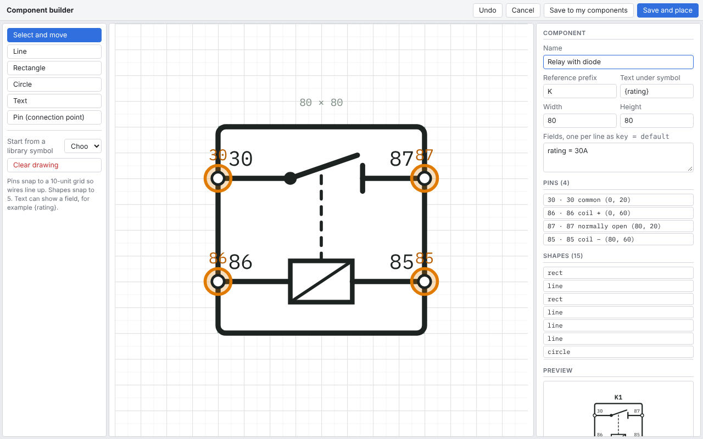

# Component builder and My components

The library covers the common parts of a vehicle loom, but sooner or later you need something it does not have: a particular switch panel, a controller with its own pinout, a sensor. The component builder lets you draw your own symbol, give it pins and fields, and save it to **My components** so you can use it in any project.

The builder's own screen is in English only, whatever language the rest of LoomWright is set to.

## Opening the builder

- **Tools › Component builder**, or the **Builder** button on the tool rail, starts a new component.
- **New** under **My components** in the Parts pane does the same.
- To change a component you made earlier, click **Edit** on it under **My components**, or select one on the sheet and click **Edit component design** in its Properties.

The window has three parts: the tools on the left, the symbol being drawn in the middle, and the component's details on the right. The dashed box in the middle is the component's outline, with its size written above it.

## Starting from a library symbol

Often the quickest start is a library part that is nearly right. Choose it under **Start from a library symbol**. The builder copies its shapes, pins and fields, and you change what you need. The library part itself is not changed.

**Clear drawing** removes every shape and pin, to start from nothing.

## Drawing the symbol

Pick a tool, then draw in the middle:

| Tool | Key | How to use it |
| --- | --- | --- |
| Select and move | <kbd>V</kbd> | Click a shape or pin to select it; drag it to move it. |
| Line | <kbd>L</kbd> | Drag from one end to the other. |
| Rectangle | <kbd>B</kbd> | Drag from one corner to the opposite corner. |
| Circle | <kbd>C</kbd> | Drag from the centre outwards. |
| Text | <kbd>T</kbd> | Click where the text goes, then type it in the panel on the right. |
| Pin (connection point) | <kbd>P</kbd> | Click on the edge of the symbol where a wire should attach. |

- Shapes snap to a 5-unit grid. Pins snap to the 10-unit grid of the drawing, so wires line up with them, and stay inside the outline.
- <kbd>Esc</kbd> goes back to **Select and move**.
- <kbd>Delete</kbd> removes the selected shape or pin.
- <kbd>Ctrl</kbd>+<kbd>Z</kbd>, or **Undo**, undoes the last change in the builder.

Select a shape to change it exactly on the right: its position and size, line width, whether it is dashed, its fill (none, white or black), and for text its words, size and alignment. **Duplicate** copies it and **Delete shape** removes it.

## Pins

Every pin needs an id that is different from the others on the component. The builder numbers them 1, 2, 3… as you place them. Select a pin to change its **Pin number / id**, such as `30`, `87` or `GND`, and its **Description**, such as `Switched feed`. Both appear in the Properties pane when the component is used, and the id is what the wire list shows, as in `K5:87`.

Choose ids with care: LoomWright treats pins with ids such as `-`, `31`, `E`, `GND` or `85` as earth pins when it checks circuits for an earth return.

The **Pins** list on the right shows them all; click one to select it.

## The component's details

At the top of the right-hand panel:

- **Name**: as it appears in the Parts pane and the parts list.
- **Reference prefix**: the letter for its references, such as `K` for a relay or `S` for a switch. New parts get the next free number after it.
- **Text under symbol**: written under the symbol on the drawing. Put a field name in braces to show the field's value, such as `{rating}`.
- **Width** and **Height**: the size of the outline, in steps of 20.
- **Fields, one per line as key = default**: the values each use of the component can have, such as `rating = 15A` or `legend = WORK LAMP`. Each field appears in the Properties pane when the part is placed.

Text shapes can show fields too: a text of `{legend}` shows each part's own legend.

The **Preview** shows the component as it will look on a sheet.

## Saving

- **Save to my components** saves the component and closes the builder.
- **Save and place** saves it and drops one onto the current sheet.
- **Cancel** closes the builder without saving.

A component needs at least one shape, and its pins need different ids, before it can be saved.

Saved components appear in the Parts pane under **My components**, and can be used in any project on this computer. When you place one, LoomWright also stores a copy of it in the project file, so the project still opens correctly on a computer that does not have it. If you change a component's design, the open project picks up the new design straight away, and other projects take it the next time you place that component in them.

## Changing a component that is already wired

You can open a component that is already used in your drawings, change it and save it without losing its wiring:

- **Renaming a pin** keeps its wires. Change `OUT` to `87` and every wire on `OUT` moves to `87`, in this project and in other projects the next time they take the new design.
- **Moving a pin, redrawing the symbol, or adding pins and fields** changes nothing in the wiring.
- **Removing a pin that has wires on it** is the only change that disconnects anything. The builder warns you first and names the pins and how many wires they have. Put the pin back, or click **Save** again to go ahead. Afterwards <kbd>Ctrl</kbd>+<kbd>Z</kbd> on the drawing brings the wires back.

## Components with fuses and relays inside

A component can hold real fuses and relays, such as a relay and fuse box with its relays fed through their own fuses. The trace, the live test, the voltage solver, the fuse and relay schedule and the design checks then work through it as if each fuse and relay were drawn on the sheet. They are named after the box: fuse F2 in FB1 is **FB1/F2**, and its rating comes from the box's own F2 field.

The builder shows what is inside a component under **Inside this component**, and keeps those parts linked to their pins when you rename a pin. To make a component like this, ask the Claude add-on (give it a picture of the box's diagram), or import a component file that has one. The format is in `docs/components.md`.

## Deleting a component

Open the component in the builder and click **Delete from library**, then click again to confirm. It is removed from **My components**. Projects that already use it keep their own copy, so their drawings do not change.

## Sharing components and blocks

**Tools › Export my components and blocks** saves all your components, your blocks and your saved palette of colours in one file, `loomwright-library.json`. Use it to:

- back up your library,
- move it to another computer,
- share it with someone else.

**Tools › Import components and blocks** reads such a file and adds its contents to your library. A component or block with the same id as one you have already is replaced by the one in the file.

## Components from a picture, with Claude

With the optional Claude add-on, Claude can make a component for you from a photo or a datasheet picture of a part's pinout. It appears under **My components** the next time you switch back to LoomWright. Check the pins against the part before you rely on it. See [The Claude add-on](26-claude-add-on.md).
