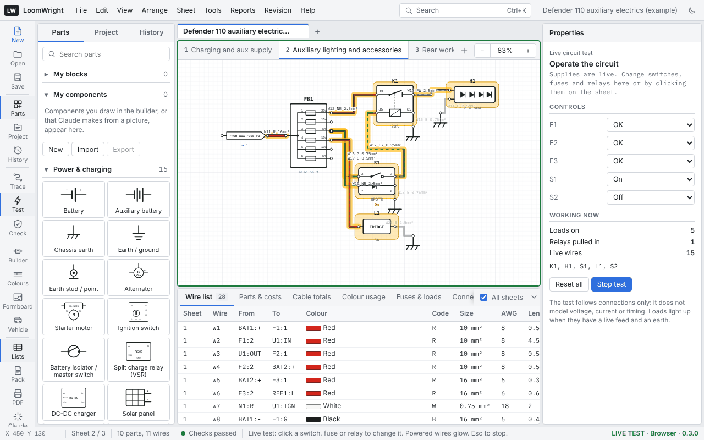

# Circuit trace and live test

Two tools help you follow a circuit through a drawing: the **trace**, which lights up everything connected to one wire, and the **live test**, which lets you operate switches and fuses to see what would run.

## Tracing a circuit

A trace highlights one circuit: every wire joined to the one you pick, on every sheet.

To start a trace, do any of these:

- hold <kbd>Alt</kbd> and click a wire or a pin,
- select a wire and press <kbd>T</kbd>, or click **Trace** on the tool rail,
- click **Trace circuit** in a wire's Properties,
- click the **⤳** beside a pin in a part's Properties,
- click a row in the **Circuits** list.

While a trace is on:

- the traced wires are highlighted, and the sheet tabs mark the other sheets the circuit reaches,
- the Properties pane shows the circuit's name, how many wires and connections it has and on how many sheets, and lists its wires sheet by sheet. Click a wire in the list to go to it,
- the status bar says **Tracing a circuit across all sheets. Esc to clear.**

Press <kbd>Esc</kbd> to clear the trace.

### What counts as one circuit

A circuit, for the trace, is everything joined by wire with nothing in between that can break it. The trace follows wires through:

- splices, busbars, terminal strips and bulkhead grommets,
- mated connector pairs, cavity to cavity,
- off-sheet references and net labels with the same name, to other sheets,
- the same part drawn on several sheets.

It stops at anything that can switch or break the circuit, or that uses the power: switches, fuses, relays and loads. So tracing the feed to a lamp shows the wires from the switch to the lamp, not the battery side of the fuse. Trace the other side separately.

All earth points belong to one circuit, called **EARTH**.

### The circuit's name

LoomWright names a traced circuit from, in order of preference: the name of a net label or off-sheet link on it; the circuit names you gave its wires; a supply it starts from (such as `BAT1 +`). Otherwise it is numbered.

## The Circuits list

The **Circuits** tab in the Lists pane lists every circuit in the project: its name, how many wires and connections it has, which sheets it is on, and the pins it goes to. Click a row to trace it.

This list is a good way to check a drawing: a circuit you expected to be one piece that shows up as two usually means a missing wire or a mistyped link name.

## The live test

The live test treats every battery as live and lets you operate the switches and fuses, to see which wires would carry power and which loads would run.

Start it with **Tools › Live circuit test**, or the **Test** button on the tool rail. The sheet gets a green border, the status bar shows **LIVE TEST**, and you cannot edit the drawing until you stop.

### Operating parts

Click a part on the sheet to move it to its next position, or choose its position under **Controls** in the Properties pane. The parts you can operate, and their positions, are:

| Part | Positions |
| --- | --- |
| Blade fuse, Maxi / MIDI / ANL fuse, fusible link, circuit breaker | OK, Blown |
| Switch, push button (normally open), pressure and temperature switches | Open, Closed |
| Push button (normally closed) | Closed, Pressed (open) |
| Changeover switch | Position 1, Position 2 |
| Double-pole changeover | Position A, Position B |
| Illuminated rocker switch | Off, On |
| Rocker switch, 8 pin (Contura style) | Down, Off, Up |
| Rotary switch | Off, then each position |
| Ignition switch | 0 Off, I Accessory, II Ignition, III Start |
| Battery isolator | Off, On (starts On) |
| Door / pin switch | Door shut, Door open |
| Split charge relay (VSR) | Open, Combined |
| Flasher unit | Off, Flashing (on) (starts on) |
| Winch control box | Stop, Wind in, Wind out |
| Alternator | Engine off, Engine running |
| Solar panel | Dark, Sun |

**Relays are not operated by hand.** A relay pulls in by itself when its coil has a feed on one side and an earth on the other, as a real one would. To test a relay circuit, operate the switch that feeds its coil.

Fuse boxes always pass power to every way; to test a blown fuse, use separate fuse parts.

### What you see

- **Powered wires glow**, and loads that have both a live feed and an earth are highlighted as working.
- **Working now**, in the Properties pane, counts the loads on, the relays pulled in and the live wires, and names the parts that are working.
- If a position connects a supply straight to earth, a **Short circuit** warning names the supply.
- Switches show their position under them on the sheet.

**Reset all** puts every part back to its starting position. **Stop test**, or <kbd>Esc</kbd>, ends the test.

> The live test follows connections only. It does not model voltage, current, voltage drop or timing, so it cannot tell you that a wire is too thin, a fuse too small, or a relay too slow. It answers one question: with the switches set like this, is there a path from a supply, through this load, to earth?

## Using them together

A good way to check a new circuit:

1. Trace each wire you have added, to make sure it joins what you meant and nothing else.
2. Run the live test, operate the switch for the circuit, and check the right load comes on and nothing else does.
3. Blow its fuse, and check the load goes off.
4. Open the **Checks** list and deal with anything new.
