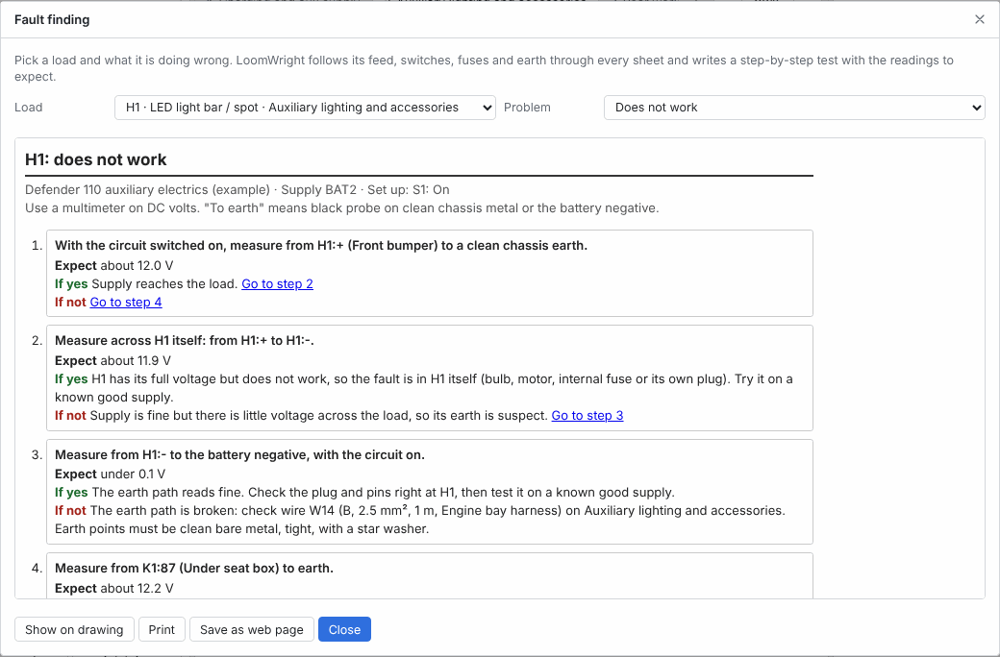

# Fault finding

Fault finding writes a step-by-step test for a load that does not work as it should. LoomWright follows the load's feed, switches, fuses and earth through every sheet, and gives the reading a meter should show at each point. Take the sheet to the vehicle, work down the steps, and it narrows the fault to one wire, joint or part.

> The expected readings are worked out from the drawing and assume healthy parts. If the loom is not wired as drawn, the readings will differ. A fault sheet is a guide to testing, not a guarantee of what is wrong. See the [Disclaimer](28-disclaimer.md).

## Opening fault finding

Use any of these:

- **Tools › Fault finding…**. If a part is selected, the dialog starts on that part.
- **Fault finding…** in the Properties pane of a selected load or relay that has a reference.
- **Fault finding…** at the bottom of the Properties pane during the [live test](11-trace-and-live-test.md#volts-and-amps).

Fault finding works on loads and relays that have a reference, such as `H1` or `K1`. If no load in the project has one, LoomWright says "Give your loads a reference (H1, M1 and so on) to fault-find them."

## Choosing the load and the problem

- **Load** lists every load and relay with a reference, with its component name, and its sheet when the project has more than one.
- **Problem** is what the load is doing wrong:

| Problem | Use it when |
| --- | --- |
| Does not work | The load does nothing when it should run. |
| Will not switch off | The load runs when it should be off. |
| Keeps blowing its fuse | The fuse that feeds it blows. |
| Dim, slow or weak | The load runs, but a lamp is dim, a motor slow or a pump weak. |

The steps change as soon as you pick a different load or problem.

## How LoomWright sets up the test

First, LoomWright finds switch positions in which the load should run. It starts from the positions on the drawing and tries up to three changes to switches, buttons and supplies, with every fuse intact. Any position that differs from the drawing is listed under **Set up**, for example `S1: Closed`. Set the switches that way before you start.

It then works out the voltage at every point along the feed and the earth, the same way as the [live test](11-trace-and-live-test.md#volts-and-amps), with a charged battery: 12.6 V at rest on a 12 V system. Fill in wire sizes and lengths, and give loads a current or wattage, for the closest figures.

If the load does not run in any position it tries, the dialog says so. Check that the load has a fused feed and an earth on the drawing.

## Reading a fault sheet

A fault sheet has:

- a title, such as `H1: does not work`,
- the supply it follows, and the **Set up** positions,
- a reminder: "Use a multimeter on DC volts. "To earth" means black probe on clean chassis metal or the battery negative.",
- numbered steps. Each says what to measure, and under **Expect**, the reading for a healthy circuit,
- under each step, **If yes** (the reading is as expected) and **If not**. Each either names the likely fault, or has a **Go to step** link to the next step to try,
- **Expected voltages along the feed**: click it to open a table of every test point from the supply to the load, with its expected volts,
- notes at the end, such as wires that have no length, or loads with no rating.

Work down the steps and follow the links. Big differences from the expected reading matter. Small ones do not.

## The four problems

### Does not work

The sheet starts at the load:

1. The feed at the load, to earth.
2. The voltage across the load itself. Full voltage across a load that does not work means the fault is in the load: the bulb, motor, its internal fuse or its own plug.
3. The earth, from the load's earth pin to the battery negative. More than 0.1 V there means a bad earth path.

If there is no feed at the load, the next steps go back along the feed one test point at a time, towards the supply. The fault lies between the first point that reads correctly and the last point that did not. Depending on what is there, the sheet says:

- **A wire or connector**: look for a broken wire, a crimp pulled off, a pin pushed back in its housing, or corrosion.
- **A fuse**: it is blown or its holder is bad. Work through the **Keeps blowing its fuse** sheet before fitting a new one.
- **A switch**: it is not closing. Check it with a meter, or replace it.
- **A relay**: it is not switching. Two more steps test its coil feed and its coil earth. If both are good, replace the relay.
- **A power module output**: check its control input, its earth, and whether the output has tripped.

### Will not switch off

LoomWright finds switch positions in which the load should be off, and lists them under **Set up**. The steps then:

1. Measure the feed at the load with it meant to be off.
2. Measure the output of each switch, relay or module output between the supply and the load. A relay that passes current with no feed on its coil has welded contacts.
3. List any other wires that join the feed after the switching part. Disconnect them one at a time to find a back-feed.
4. Check whether the load is switched on its earth side, and the switched earth wire is touching the chassis.

If the drawing has no switch that turns the load off, the sheet says so.

### Keeps blowing its fuse

The first step asks when the fuse blows:

- **Straight away when fitted, with everything off**: a step measures resistance from the load side of the fuse holder to chassis, with the fuse out. Under about 1 Ω is a short between the fuse and the first switch.
- **Only when the load is switched on**: a step measures the same resistance with the circuit switched on. A low reading is a short after the switch or inside a load. The sheet lists the loads on the same fuse to disconnect one at a time.
- **After running a while, or under heavy load**: a step measures the current with a clamp meter, and gives the current to expect and the fuse rating.

The notes list any wires on the fuse that pass through a grommet or bulkhead, the usual places for chafing. If the expected current is close to the fuse rating, a note says so. Every fuse sheet ends with: "Never fit a bigger fuse just to stop it blowing. The fuse protects the wire."

If no fuse protects the load on the drawing, the sheet says to fit one.

### Dim, slow or weak

These steps are voltage drop tests, done with the load running:

1. The supply at the battery or charger. A 12 V battery should read 12.4 to 12.7 V with the engine off, and 13.8 to 14.4 V with it running.
2. The drop along the whole feed, from the supply to the load. Under 0.5 V is good.
3. The drop across each wire, fuse, switch and connector on the way. A fuse, switch or joint should drop no more than 0.2 V.
4. The drop on the earth side, from the load's earth to the battery negative. Under 0.2 V is good.

If supply and earth are both good, the load itself is weak.

## Showing, printing and saving

The buttons at the bottom of the dialog:

- **Show on drawing** closes the dialog and highlights the load's feed and earth path, like a [trace](11-trace-and-live-test.md#tracing-a-circuit). It stops the live test if it is running. Press <kbd>Esc</kbd> to clear it.
- **Print** prints the fault sheet on A4.
- **Save as web page** saves the sheet as a file named after the project, the load and the problem. For a project called Camper, the **Does not work** sheet for H1 is `camper-fault-H1-dead.html`. It opens in any web browser, so you can read it on a phone at the vehicle. The **Go to step** links work there too.

The [build pack](15-build-pack-and-labels.md#the-build-pack) can also hold a **Does not work** sheet for every load with a reference. Tick **Fault-finding sheets** when you make the pack.

## What fault finding cannot do

- It works from the drawing. It cannot see a wire that was added, moved or left out on the vehicle.
- It assumes healthy parts and clean joints, so a part that is failing in an unusual way can give readings it does not expect.
- It is written for low-voltage DC circuits. Household circuits, three-phase motors, indicator lamps on a panel and PLC cards are not offered. Contactor coils in a 24 V control circuit are offered as relays. There, use the power supply's − terminal where the sheet says battery negative.
