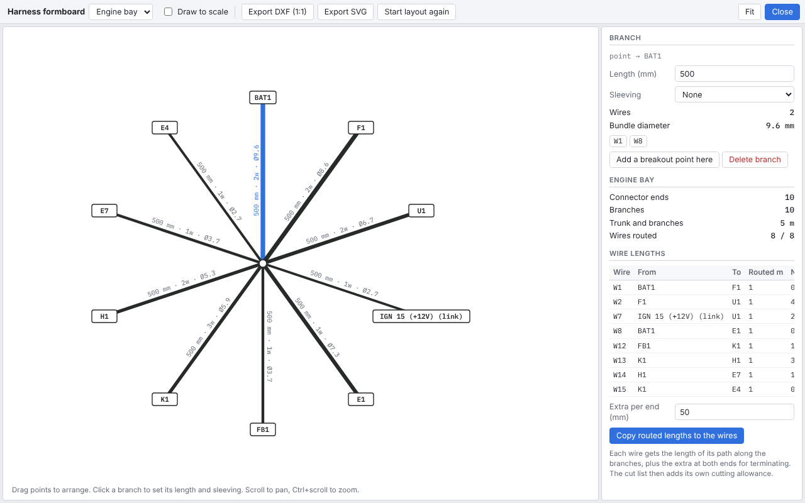

# Harness formboard

A wiring diagram shows how things connect, not where the wires run. To make up a harness on the bench you need its physical shape: a trunk, the branches that leave it, how long each is, and which connector sits at the end of each. That is a **formboard** layout, and LoomWright can draw one for each harness.

The formboard also works out wire lengths from the route each wire takes, and can copy them back onto the wires.

## Opening the formboard

Give your wires harness names first (see [Harnesses](07-harnesses-connectors-and-ends.md#harnesses)). Then open **Tools › Harness formboard**, the **Formboard** button on the tool rail, or the formboard button beside a harness in the Project pane.

Choose the harness from the list at the top left. Each harness has its own layout, saved in the project file.

## The first layout

The first time you open a harness, LoomWright draws it as a star: one centre point, with a branch of 500 mm out to each **connector end**.

A connector end is a part that wires in this harness go to, named by its reference, such as `F1` or `K1`. A few things are joined into one end:

- a mated connector pair is one end,
- an off-sheet reference or net label is an end called by its link name, marked `(link)`.

The star is only a starting point. Reshape it to match the vehicle.

## Shaping the layout

- **Drag** a point or connector end to move it.
- **Click a branch** to select it. In the panel on the right, set its **Length (mm)** and **Sleeving**.
- **Add a breakout point here** splits the selected branch in two with a new point in the middle, sharing the length. Use breakout points where the harness divides.
- Select a point and use **Join to another point…**, then click the point or connector end to join it to. That adds a branch between them. <kbd>Esc</kbd> cancels.
- Give a breakout point a **Name**, such as `Bulkhead grommet`, so the layout is easy to read.
- Select a connector end and click **Show on drawing** to close the formboard and find that part on its sheet.
- **Delete branch** removes the selected branch. **Delete point** removes a breakout point; if two branches met there, they are joined into one. Connector ends cannot be deleted, because they come from the wires; delete a branch instead.
- **Start layout again** replaces the layout with a new star. It can be undone.

<kbd>Ctrl</kbd>+<kbd>Z</kbd> and <kbd>Ctrl</kbd>+<kbd>Shift</kbd>+<kbd>Z</kbd> undo and redo, <kbd>Delete</kbd> deletes what is selected, and <kbd>0</kbd> fits the layout to the window. Scroll to pan, and hold <kbd>Ctrl</kbd> while scrolling to zoom.

### Drawing to scale

While you arrange the layout, branches are drawn wherever you put the points. Tick **Draw to scale** to redraw it with every branch at its real length, which is what you want to print or export. Untick it to go back to arranging.

## What each branch shows

Each branch is labelled with its length, the number of wires in it (such as `2w`), and an estimate of the bundle diameter (such as `Ø9.6`). Select a branch to see:

- the two points it joins,
- how many wires it carries, and their numbers,
- the **Bundle diameter**, estimated from the wire sizes and insulation,
- with a sleeving chosen, a suggested **Sleeve size** that leaves some room.

Sleeving types are convoluted conduit, split convoluted conduit, braided PET sleeve, heat-shrink sleeve (DR-25 type), cloth harness tape and PVC tape. LoomWright suggests a size for the first four.

The bundle diameter is an estimate from typical cable sizes. Measure a test bundle, or check the cable maker's outside diameters, before ordering sleeving.

## Grommets and bulkhead holes

To check that a bundle fits through a hole in a panel or bulkhead:

1. Put a breakout point where the harness passes through the hole, and select it.
2. Set **Type** to **Grommet or bulkhead hole**.
3. Fill in **Hole (mm)**: the inside diameter of the hole or grommet.

The panel then shows how many **Wires through** it, the **Bundle diameter**, and the **Fill** as a percentage of the hole. On the layout the point is drawn as a ring, labelled with its name, the hole size and the fill, such as `Bulkhead grommet Ø20 · 64%`.

- Over 100%: "The bundle will not fit through this hole." The ring turns red and the design checks warn.
- Over 80%: "Tight: keep the bundle under 80% of the hole for sleeving and a spare wire." The ring turns red and the design checks note it.

The exported formboard shows each hole with its size. Fault finding also uses grommets: a fuse that keeps blowing lists the wires on it that pass through one, as they are the usual places for chafing. See [Fault finding](12-fault-finding.md#keeps-blowing-its-fuse).

## Heat

The **Heat** section of the panel sets **Air around this harness (°C)**. Leave it blank to use the default: 80 °C for a harness with `engine`, `bay`, `exhaust` or `motor` in its name, and 30 °C for any other.

LoomWright reduces each wire's guide current for this temperature, and for the loaded wires bundled with it in the busiest branch it runs through. A wire carries current when its **Current** is filled in. See [Heat and bundling](04-wires-and-colours.md#heat-and-bundling).

Wires that carry more than their reduced rating, or more than 90% of it, are listed under **Heat**, with the size to use. If the air is as hot as a wire's insulation is rated for, it says so.

## Harness totals

With nothing selected, the panel shows the harness's totals: the number of connector ends and branches, the total length of trunk and branches, and **Wires routed**: how many of the harness's wires have a path along the branches between their two ends.

If some wires have no path, LoomWright says so. Join their connector ends to the layout.

## Wire lengths

Each wire's length can be worked out from its route: the lengths of the branches between its two ends.

The **Wire lengths** table lists each wire in the harness with its **Routed m** length and the length it has **Now m**. To use the routed lengths:

1. Set **Extra per end (mm)**: the length added at each end for reaching the terminal and making it off. It starts at 50 mm.
2. Click **Copy routed lengths to the wires**.

Each wire then gets its routed length plus the extra at both ends. It can be undone with <kbd>Ctrl</kbd>+<kbd>Z</kbd>.

The cut list then adds its own cut allowance on top for stripping and terminating, as for any wire; see [Cut list](14-lists-and-reports.md#cut-list). If you set the extra per end generously, you can lower the cut allowance to match.

## Exporting the formboard

- **Export DXF (1:1)** saves the layout as a DXF drawing in millimetres at full size, to print on a plotter or roll paper and pin to a board, or to open in a CAD program.
- **Export SVG** saves it as a picture.

The build pack includes the formboard of every harness you have laid out. See [Build pack and wire labels](15-build-pack-and-labels.md).

**Close** (or <kbd>Esc</kbd>) goes back to the drawing.
