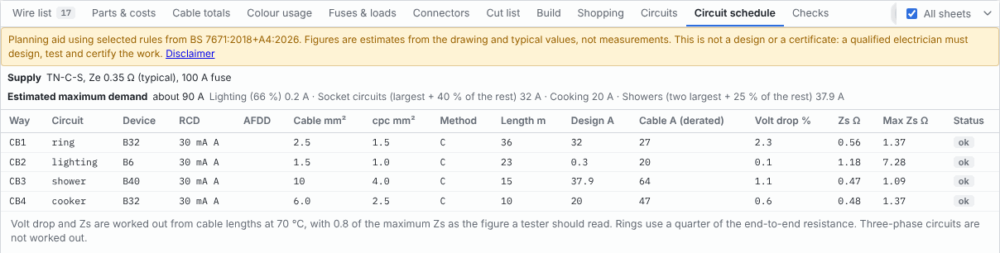

# Household wiring

LoomWright can draw the circuits from a home's consumer unit as a single-line diagram. From the drawing it makes a circuit schedule, estimates the maximum demand, and checks the circuits against a selection of rules from BS 7671.

> **A planning aid only.** The household checks and figures are guidance from selected rules of BS 7671:2018+A4:2026. They are not a design, not a test and not a certificate. Passing every check does not mean the work meets BS 7671 or the Building Regulations. Mains electricity can kill and start fires. A qualified electrician must design, install, test and certify the work, and some work must be notified to building control. Read the [Disclaimer](27-disclaimer.md) before you use this chapter.

## Starting a household project

1. Choose **File › New project**.
2. Click an empty part of the sheet, and under **Drawing** set **Project type** to **Household (UK mains)**.
3. Read the disclaimer that appears the first time, and click **I understand**.
4. Under **Mains installation**, set the **Building**, the **Country (building rules)**, the **Usual installation method** and the **Ambient temperature °C**. See [Sheet and drawing settings](05-projects-and-sheets.md#sheet-and-drawing-settings).

A household project sets the system voltage to 230 V, and changes **Land Rover / British** colour codes to **DIN**. New wires start as grey 2.5 mm² cable. The **Household**, **Loads library** and **Wiring & connectors** parts come first in the Parts pane, and a **Circuit schedule** tab appears in the Lists pane.

To start from a ready-made board, place the [starter consumer unit](#the-starter-consumer-unit).

## How a household drawing works

A household drawing is a single-line diagram: **one line is one cable**. A line from a breaker to a socket stands for the whole twin and earth cable, with its line, neutral and earth. Do not draw the conductors separately.

- Most household parts have an **in** pin and an **out** pin. Draw the cable that feeds a part into its **in** pin, and the cable to the next point from its **out** pin.
- A **circuit** is everything wired after a breaker's **out** pin: the cables, and the sockets, lights, switches, alarms, junction boxes and loads they reach.
- A **ring** is a circuit whose cables loop back to the breaker. To close a ring, draw the last cable from the last socket's **out** pin back to the breaker's **out** pin. LoomWright finds the loop by itself.
- A **spur** is a cable that leaves the ring and does not come back. A spur through a **Fused connection unit** is a fused spur.
- To feed the breakers, wire the main switch's **out** pin to the first breaker's **in** pin, and chain the **in** pins of the other breakers to it. The starter consumer unit marks these short wires with the note `Busbar`.
- An **RCBO** gives its own circuit RCD protection. An **MCB** has RCD protection when an **RCD** sits between it and the main switch: wire the main switch to the RCD's **in** pin, and the RCD's **out** pin to the MCBs.
- Net labels and off-sheet references join cables across sheets, as on any drawing.

Give every cable its **Size** and **Length (m)**. Without lengths, LoomWright cannot work out voltage drop or earth fault loop impedance.

## The supply and the consumer unit

These parts are in **Household**:

| Part | Fields |
| --- | --- |
| Supply (cut-out and meter) | **Supply fuse (A)**, **Earthing** (TN-C-S (PME), TN-S or TT), **Ze (Ω), blank for typical**, **Prospective fault current (kA)**, **Earth rod resistance RA (Ω, TT only)**, **Supply** (public, or private from your own transformer or generator) and **Phases**. |
| Main switch (consumer unit) | **Rating (A)**, **Consumer unit case** (metal or plastic), and whether the **Consumer unit** is new or replaced, or existing and unchanged. |
| MCB (circuit breaker) | **Type (curve)** B, C or D, **Rating (A)**, **Poles**, **Circuit**, **Floor area served (m², rings)**, **Arc fault detection (AFDD)** and **New or existing**. |
| RCBO (breaker with RCD) | As an MCB, plus **Trip current (mA)** and **RCD type** (AC, A, F or B). |
| RCD (residual current device) | **Rating (A)**, **Trip current (mA)** and **RCD type**. |
| Surge protection device (SPD) | **Type** 1, 2 or 1+2. |
| Main bonding (gas, water, oil) | **Bonded to** and **Conductor (mm²)**. |

Leave **Ze** blank to use a typical figure for the earthing: 0.35 Ω for TN-C-S, 0.8 Ω for TN-S and 21 Ω for TT. Measure or ask for the real figure when you can.

A breaker's **Circuit** says what kind of circuit it is: ring final, radial, lighting, cooker, shower and so on. Leave it on **Work it out from the drawing** and LoomWright decides from what the circuit feeds. A shower, EV charge point, cooker, immersion heater, solar inverter or home battery decides it first, then sockets (ring or radial), then lights, smoke alarms and machines.

Set **New or existing** to **Existing, unchanged** for a circuit you are not touching. It matters for the note on notifiable work.

## Final circuit parts

Also in **Household**:

| Part | Fields |
| --- | --- |
| Socket outlet (13 A) | **Kind** (twin or single), **Outdoors**, **Bathroom** and **IP rating**. |
| Fused connection unit (fused spur) | **Fuse (A)**, **Switched** and **Bathroom**. |
| Light (luminaire) | **Watts (each)**, **How many**, **Bathroom** and **IP rating**. |
| Light switch | **Kind**: 1-way, 2-way, intermediate, pull cord or dimmer. |
| Smoke or heat alarm (mains) | **Kind**: smoke, heat or CO. |
| Junction box | Three connections. |
| Cooker (cooker control unit) | **Total rating (kW)** and **Socket on the control unit**. |
| Electric shower | **Rating (kW)**, **Rated at** 230 V or 240 V, **Bathroom** and **IP rating**. |
| Immersion heater | **Rating (kW)**. |
| EV charge point | **Rating (kW)** and **DC fault protection built in (RDC-DD)**. |

**Bathroom** is **Not in a bathroom**, **Bathroom, outside the zones**, or zone 2, 1 or 0. Give anything in a bathroom its zone and its IP rating, such as `IPX4`.

## The loads library

The **Loads library** category holds typical loads, so you can plan before you have the rating plates:

| Part | Fields |
| --- | --- |
| Appliance (loads library) | **Appliance**, **Rating (kW), blank for typical**, **Connection** (13 A plug or fixed wiring), **Bathroom** and **IP rating**. |
| Machine (loads library) | **Machine**, **Motor (kW), blank for typical**, **Current (A), from the rating plate**, **Connection** (13 A plug, 16 A socket, 32 A socket or fixed), **Phases** and **Starting**. |
| Solar PV array (strings) | **Strings in parallel**, **Modules per string**, **Module Isc (A)**, **Module Voc (V)**, **Module maximum series fuse (A)** and **Module rating (W)**. |
| Solar inverter (grid-tied) | **AC rating (kW)**, **Phases** and **DC isolator fitted**. |
| Home battery (storage) | **Inverter rating (kW)**, **Capacity (kWh)** and **Location**. |

Leave the kW blank and LoomWright uses a typical figure for the appliance or machine you pick. For example, a kettle is taken as 3 kW, an electric shower as 9.5 kW, a fridge-freezer as 0.2 kW, and a pillar drill as 0.55 kW. **Air conditioner** and the **Other** entries have no typical figure: fill in the kW. A machine's **Current (A)** from its rating plate always wins over a kW figure.

Typical figures are only a starting point. Use the rating plate of the equipment you are wiring.

## Cables and how they are run

Each cable's **Size** and **Length (m)** are under **Cable** in the wire's Properties, as for any wire. In household, factory and mixed projects the Properties pane adds an **Installation (mains guide)** section:

| Field | What it does |
| --- | --- |
| Installation method | How this cable is run. **Project default** uses the **Usual installation method** from the drawing settings. |
| Thermal insulation | Not in insulation, surrounded by 50, 100, 200 or 400 mm of insulation, or totally surrounded for more than 0.5 m. |
| Circuits grouped together | How many circuits run together with this one. |
| Grouped how | **Bunched or enclosed**, or **Clipped side by side**. |
| Earth (cpc) size | The earth conductor in the cable. **Standard twin and earth** uses the usual size for the cable, such as 1.5 mm² in 2.5 mm² cable. |
| Ambient °C | The air temperature around this cable. Blank uses the project figure. |

The installation methods are:

| Method | Meaning |
| --- | --- |
| C | Clipped to a wall or floor |
| B | In conduit or trunking on a wall |
| A | In conduit in an insulated wall |
| 100 | Above a ceiling, under up to 100 mm of insulation |
| 101 | Above a ceiling, under more than 100 mm of insulation |
| 102 | In an insulated stud wall, touching the inner skin |
| 103 | In an insulated stud wall, not touching the inner skin |

Under the fields, a note gives the cable's rating, such as "Twin and earth 2.5 mm², method C: 27 A in the table, about 27 A here once derated (Ca 1, Cg 1, Ci 1)." The table figure is reduced for the air temperature (Ca), grouping (Cg) and thermal insulation (Ci). A cable totally surrounded by insulation for more than 0.5 m is taken at half its rating.

The ratings are for twin and earth cable (70 °C PVC) from 1.0 to 16 mm². Other sizes and other cable types are not rated here: check them against the cable maker's data.

## How LoomWright works out each circuit

For each MCB or RCBO, LoomWright follows the cables from its **out** pin and works out:

- **Design current.** For a ring or radial socket circuit, the breaker rating. For other circuits, the sum of the loads: lights at their watts, showers, immersion heaters, EV charge points and inverters at their kW, and cookers at the first 10 A plus 30% of the rest (plus 5 A for a socket on the control unit). A shower rated at 240 V is taken at its lower output on 230 V.
- **Length.** For a ring, the length of cable all the way round. For other circuits, the distance to the furthest point.
- **Cable rating.** The rating of the weakest cable in the circuit, once derated.
- **Voltage drop**, from the cable size, the design current and the length. For a ring, a quarter of the end-to-end figure.
- **Earth fault loop impedance (Zs)**: Ze plus the resistance of the line and earth conductors, taken at 70 °C (1.2 times the 20 °C figure). For a ring, a quarter of the end-to-end figure.
- **Maximum Zs** for the breaker: 0.95 × 230 V, divided by the current that trips it at once (5, 10 or 20 times its rating for Type B, C or D).

Three-phase circuits are not worked out. Zs is not checked on a TT supply, where RCDs give the protection.

## The circuit schedule

The **Circuit schedule** tab in the Lists pane, or **Reports › Circuit schedule (household)**, lists every MCB and RCBO with its circuit.

At the top, a note says that the schedule is a planning aid and not a design or certificate, with a link to the [Disclaimer](27-disclaimer.md). Below it are the supply (earthing, Ze, and the supply fuse) and the [estimated maximum demand](#maximum-demand).

| Column | What it shows |
| --- | --- |
| Way | The breaker's reference. |
| Circuit | The kind of circuit, such as `ring`, `radial`, `lighting`, `shower` or `cooker`. |
| Device | The breaker's curve and rating, such as `B32`. |
| RCD | The RCD protecting it, such as `30 mA A`. |
| AFDD | `yes` if it has arc fault detection. |
| Cable mm², cpc mm² | The smallest cable size in the circuit, and its earth size. |
| Method | The installation method of the weakest cable. |
| Length m | The ring length, or the distance to the furthest point. |
| Design A | The design current. |
| Cable A (derated) | The rating of the weakest cable, once derated. |
| Volt drop % | The voltage drop at the design current. |
| Zs Ω, Max Zs Ω | The worked-out earth fault loop impedance, and the maximum for the breaker. |
| Status | **ok**, **check** if the circuit has a finding at check level, or **fix** if it has an error. Rows to fix are marked. |

Click a row to select the breaker on the drawing. **Reports › Export circuit schedule (CSV)** saves the schedule for a spreadsheet, and the [PDF export](15-build-pack-and-labels.md#export-pdf) can include it.

The figures are estimates from the drawing and typical values, not measurements. A tester's readings on the finished installation are what count.

## Maximum demand

LoomWright estimates the most the whole installation is likely to draw at once, using the household diversity method from the older edition of the IET On-Site Guide:

| Group | How it is counted |
| --- | --- |
| Lighting | 66% of the lighting load |
| Socket circuits | The largest circuit, plus 40% of the others |
| Cooking | The cooker circuits' design current |
| Showers | The two largest, plus 25% of the others |
| Water heating, EV and heating | In full |
| Other fixed loads | The first 10 A, plus 50% of the rest |

The total, and each group, are shown at the top of the circuit schedule. The checks compare the total with the supply fuse.

## The household checks

The household checks run in household and mixed projects, and in factory projects that have an MCB or RCBO. They appear in the **Checks** tab with the other [design checks](10-design-checks.md), at three levels: **error**, **check** and **info**.

Each check has a rule code. The codes are not shown in the app, but they link each check to its sources in [the list of standards sources](../standards-sources.md) in the LoomWright source code. In plain words:

| Rule | Level | What it means |
| --- | --- | --- |
| A0 | info | A breaker has no cables drawn after it yet. |
| A5-IB-IN | error | The design current is more than the breaker rating. |
| A1-RING-CABLE | error or check | A ring is not 2.5 mm² all the way round (error), or once derated each leg of the ring is good for less than 20 A (check). |
| A5-CCC | check | The cable is too small for its breaker once derated. |
| A5-INSULATION | info | Some cable is buried in insulation, so it carries about half its normal current. This is taken into account. |
| A5-SIZE | info | Some cable sizes are outside the twin and earth tables. |
| A4-VD | check | The voltage drop is over 3% for lighting or 5% for other circuits (3% more for a private supply). |
| A4-LEN | info | Some cables have no length, so voltage drop and Zs are not worked out. |
| A3-ZS | error | Zs is over the maximum for the breaker, so it may not disconnect fast enough. |
| A7-CPC-ADIABATIC | check | The earth conductor may be too small for the fault current and the time to disconnect. |
| A3-TT-RCD | error | On a TT supply, a circuit has no RCD. |
| A3-TT-RA | error | On a TT supply, the earth rod resistance times the RCD trip current is over 50 V. |
| A2-RCD-SOCKETS | error | Sockets on a breaker of 32 A or less have no 30 mA RCD. This applies to every **Building** except **Commercial or industrial**. |
| A2-RCD-LIGHTING | check | A lighting circuit has no 30 mA RCD. This also applies to every building except **Commercial or industrial**. |
| A2-RCD-BATH | error | A circuit serving a bathroom has no 30 mA RCD. |
| A2-RCD-OUTDOOR | error | Outdoor sockets have no 30 mA RCD. |
| A2-RCD-TYPE | check | The RCD is Type AC. Use Type A or better. |
| A2-RCD-EV | check | An EV charge point has no DC fault protection: it needs a Type B RCD, or Type A or F with an RDC-DD. |
| A2-RCD-INV | check | An inverter or heat pump is on a Type AC RCD. |
| A2-AFDD | error | Socket circuits in a house in multiple occupation, a high-rise flat, student accommodation or a care home have no arc fault detection. |
| A1-RING-CLOSED | error | A ring is not a closed loop. |
| A1-RING-AREA | check | A ring serves more than 100 m² of floor. |
| A1-RING-SPURS-UNFUSED | check | An unfused spur feeds more than one single or twin socket. |
| A1-RING-SPURS-COUNT | check | A ring has more unfused spurs than sockets and fixed items on the ring itself. |
| A1-RING-FIXED-LOADS | check | An immersion heater, shower, cooker or similar load is on a ring. |
| A1-DEDICATED | check | A shower, cooker, EV charge point, immersion heater, solar inverter or home battery shares its circuit. |
| A6-BATH-SOCKET | error or info | A 230 V socket is in a bathroom zone (error), or in a bathroom outside the zones, where it must be 2.5 m from the zone (info). |
| A6-BATH-ZONE | check or info | Something in zone 0 is below IPX7, or in zone 1 or 2 below IPX4 (check). Its IP rating is not set (info). |
| B4-13A | check | A machine on a 13 A plug draws more than 13 A. |
| B2-B-CURVE-MOTOR | check | A machine started direct on line may trip a Type B breaker. |
| A2-RCD-FRONTEND | check | Every circuit shares one RCD, so one fault turns off everything. |
| A2-SPD | info | No surge protection device is drawn. |
| A2-CU-CASE | check | The consumer unit case is plastic. Inside a home it must be non-combustible. |
| A7-MAIN-BOND | info or check | No main bonding is drawn (info), or bonding on a PME supply is under 10 mm² (check). |
| C-DIVERSITY | check or info | The estimated maximum demand is above the supply fuse (check), or over 80% of it (info). |
| A10-G98 | check or info | Solar and batteries total more than 16 A per phase, so the network operator must approve them before connection (check). Otherwise they are notified after connection (info). |
| A10-STRINGFUSE | check | A PV array with three or more parallel strings needs a fuse in each string. |
| A10-DC-CABLE | info | The PV string cable rating, and the voltage DC parts must take in cold weather. |
| A10-BATT-LOFT | check | A home battery is in a loft or under the stairs. |
| A8-COLOURS | error | A cable is plain green or plain yellow. |
| A8-MIXED | info | The drawing mixes old and new cable colours, so a warning notice is needed at the consumer unit. |
| A9-PARTP | info | The work includes new circuits, a new consumer unit or work in bathroom zones. In England and Wales it is notifiable under Part P. The note changes for Scotland and Northern Ireland. |

The vehicle checks for voltage drop, guide current, fuse size, missing fuses and missing earths are left out of household projects. See [Household and factory projects](10-design-checks.md#household-and-factory-projects).

## Solar PV and home batteries

To plan solar and a battery:

1. Place a **Solar PV array (strings)** and a **Solar inverter (grid-tied)** from **Loads library**. Wire the array's **+** and **−** pins to the inverter's **DC+** and **DC−** pins.
2. Give the inverter its own breaker: wire the breaker's **out** pin to the inverter's **AC** pin.
3. For a battery, place a **Home battery (storage)** and wire its **AC** pin from its own breaker. Set its **Location**.

The checks then cover the connection approval (A10-G98), string fuses (A10-STRINGFUSE), the DC cable and voltage (A10-DC-CABLE) and the battery location (A10-BATT-LOFT). The inverter and battery circuits also need suitable RCDs (A2-RCD-INV) and their own circuits (A1-DEDICATED).

## The starter consumer unit

In a household project, **Starter circuits** in the Parts pane holds **Consumer unit with RCBOs**. It has:

- a supply with a 100 A fuse on TN-C-S earthing, a 100 A main switch in a metal case, and a Type 2 surge protection device,
- four Type B RCBOs, each 30 mA Type A:
  - a 32 A ring of four twin sockets in 2.5 mm² cable,
  - a 6 A lighting circuit in 1.5 mm² with a switch, two lights and a smoke alarm,
  - a 40 A circuit to a 9.5 kW electric shower in zone 1, in 10 mm² cable 15 m long,
  - a 32 A circuit to a 10 kW cooker in 6 mm² cable 10 m long.

Every cable has a size and a length, so the circuit schedule fills in straight away.

The sizes, ratings and lengths are examples to change, not a design. Change them to your own circuits, then add your own.

## What the household tools do not do

- They do not inspect, test or certify anything. A tester's readings on the finished installation are what count.
- The [live test](11-trace-and-live-test.md#mains-and-factory-parts-in-the-live-test) shows which lights, sockets and appliances are live as you switch breakers and switches, but not their volts and amps, because one line stands for the whole cable. [Fault finding](12-fault-finding.md) does not work on single-line household circuits.
- Three-phase circuits are not worked out.
- Only twin and earth cable is rated.
- Only a selection of BS 7671 is checked. The known limits are listed in [the list of standards sources](../standards-sources.md) in the LoomWright source code.
