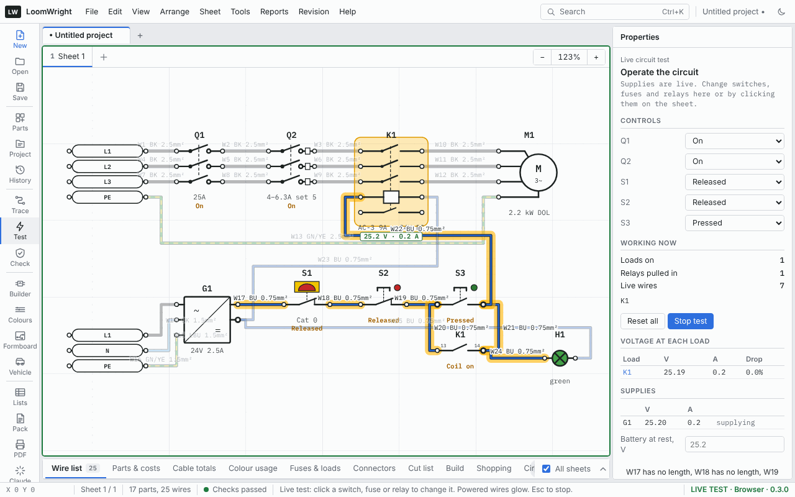

# Factory, workshop and control panels

LoomWright can draw machine control panels, motor starters and workshop supplies. It lists the motors, terminals and PLC inputs and outputs, numbers wires the way panel drawings do, and checks the drawing against a selection of recommendations from BS EN 60204-1.

> **A planning aid only.** The factory checks are guidance from selected recommendations of BS EN 60204-1, and the workshop checks from selected rules of BS 7671. They are not a design, not a test and not a certificate. Passing every check does not mean a machine or panel meets the standards or the Electricity at Work Regulations 1989. A machine's safety functions come from its risk assessment, which LoomWright does not do. A qualified person must design, build, test and certify the work. Read the [Disclaimer](28-disclaimer.md) before you use this chapter.

## Starting a factory project

1. Choose **File › New project**.
2. Click an empty part of the sheet, and under **Drawing** set **Project type** to **Factory, workshop and control panels**.
3. Read the disclaimer that appears the first time, and click **I understand**.
4. Set the **System voltage** to match your control circuit, such as 24 V. The live test uses it to work out coil currents.

A factory project changes **Land Rover / British** colour codes to **DIN**, and new wires start as black 1.5 mm². The **Factory & panels**, **Loads library**, **Household**, **Relays & control** and **Wiring & connectors** parts come first in the Parts pane. **Motors**, **Terminal plan** and **PLC I/O** tabs appear in the Lists pane, and **Tools › Number wires by potential…** appears in the menu.

To start from a ready-made circuit, place the [direct-on-line starter](#the-direct-on-line-starter).

### Workshop supplies

A workshop's sockets and machine supplies are drawn like household circuits, from MCBs or RCBOs, one line per cable. As soon as a factory project has an MCB or RCBO, the household checks and the **Circuit schedule** tab are added. See [Household wiring](18-household-wiring.md).

For machines, use **Machine (loads library)**. Pick the machine, then give it the current from its rating plate, its connection (13 A plug, 16 A socket, 32 A socket or fixed), its phases and how it starts. The checks warn when a machine draws more than a 13 A plug can supply, and when a motor started direct on line may trip a Type B breaker.

## Panel parts

These parts are in **Factory & panels**:

| Part | Fields | Pins |
| --- | --- | --- |
| Isolator, three-pole | **Rating (A)** | L1, L2, L3 in; T1, T2, T3 out |
| Circuit breaker, three-pole | **Type (curve)**, **Rating (A)** | As the isolator |
| Motor circuit breaker (MPCB) | **Adjustment range (A)**, **Set to (A)** | As the isolator |
| Contactor | **AC-3 rating (A)**, **Coil** (24V DC, 24V AC, 110V AC or 230V AC) | L1, L2, L3 and T1, T2, T3 main contacts; A1, A2 coil; 13, 14 auxiliary contact (normally open) |
| Contact of a contactor or relay | **Contact** (normally open or normally closed), **Terminal numbers** such as `13-14` | Two. The terminal numbers are written beside them, but the lists call the pins 1 and 2. |
| Overload relay (thermal) | **Adjustment range (A)**, **Set to (A)** | L1, L2, L3 and T1, T2, T3; 95, 96 trip contact (normally closed) |
| Motor, three-phase | **Power (kW)**, **Full-load current (A), blank to estimate**, **Starting** (DOL, Star-delta, Soft start or VFD), **Duty** (normal, or inching or plugging) | U, V, W and PE |
| Push button, start (NO) | **Button colour**, green to start with | 13, 14 |
| Push button, stop (NC) | **Button colour**, red to start with | 11, 12 |
| Emergency stop | **Stop category** 0, 1 or 2 | 11, 12 |
| Indicator lamp | **Colour** | X1, X2 |
| Control transformer | **Primary (V)**, **Secondary (V AC)**, **Rating (VA)** | H1, H2 primary; X1, X2 secondary |
| Power supply, 24 V DC | **Output (V DC)**, **Output (A)** | L, N, PE in; + and − (0 V) out |
| PLC digital inputs, PLC digital outputs | **Channels** (1 to 32), **Address prefix** (`I0.` or `Q0.`), **Text inside** | One per channel, such as `I0.0`, and COM |
| Variable speed drive (VFD) | **Rating (kW)**, **Supply** (single or three phase) | L1, L2, L3, PE in; U, V, W out; DI run input |
| Safety relay | **Text inside** | A1, A2, S11, S12, S21, S22, 13, 14, 23, 24 |

A **Terminal strip**, in **Wiring & connectors**, has **Ways** with an A and a B side. Terminal A1 is joined to B1, A2 to B2 and so on.

## Drawing a panel

Panel drawings show every conductor, not one line per cable. Draw L1, L2, L3 and PE as separate wires, and the control circuit wire by wire.

- Use **Net labels** for the supply rails, such as `L1`, `L2`, `L3`, `N` and `PE`. Every net label with the same name is joined, on any sheet.
- Give each wire the colour it will have. The colour checks look at what each wire is for: see [The factory checks](#the-factory-checks).
- Wire a 24 V control circuit from the power supply's **+** pin, through the emergency stop, stop and start buttons, to the coil's **A1** pin, and from **A2** back to the supply's **−** pin.

## A contactor's coil and its contacts

On a panel drawing, a contactor's coil is usually in the control circuit and its contacts are drawn where they work. To do that:

1. Place a **Contactor**. Its main contacts and coil are drawn together, with an auxiliary contact 13–14.
2. Where you need another contact, place a **Contact of a contactor or relay**.
3. Give it the same reference as the contactor, such as `K1`.
4. Set **Contact** to normally open or normally closed, and the **Terminal numbers**, such as `13-14` or `21-22`.

A contact and its contactor sharing a reference is not a duplicate, and the checks do not flag it. When they are on different sheets, the contactor is labelled with where its contacts are, such as `contacts on 2/B4`, and each contact with where its coil is, such as `coil on 1/C3`. Click the label to go there.

In the live test, the contact follows the contactor or relay with the same reference.

When you paste parts, or place a block or starter circuit, a coil and its contacts that shared a reference still share one, with a new number.

## Testing a start and stop circuit

The [live test](11-trace-and-live-test.md#the-live-test) can run a 24 V DC or control transformer circuit. To test the direct-on-line starter:

1. Place the starter, and set the **System voltage** to 24 V.
2. Choose **Tools › Live circuit test**, or click **Test** on the tool rail.
3. Click the start button, or set it to **Pressed** under **Controls**. The contactor pulls in, its contacts show **Coil on**, and the wires to the coil glow. **Voltage at each load** shows the coil's volts and amps.
4. Set the start button back to **Released**. The hold-in contact keeps the contactor in, and the motor M1 keeps running from the `L1`, `L2` and `L3` labels.
5. Set the stop button or the emergency stop to **Pressed**. The contactor drops out and the motor stops. It stays out when you release the stop button, until you press start again.

Things the live test does not do on a panel:

- **The power side shows what runs, not amps.** The motor runs when `L1`, `L2` and `L3` reach it, but the live test does not work out motor currents. Use the **Motors** list for those.
- **Only labels named L1, L2 and L3 are live.** If your drawing names the phases differently, such as `L1-400V`, the motor will not run in the live test.
- **PLC cards do not run.** Their inputs and outputs are not switched.

[Fault finding](12-fault-finding.md) offers each contactor coil as a relay. In a factory project the steps are worded for a panel: the power supply's − terminal and 0 V take the place of the battery negative and chassis earth.

## The factory checks

The factory checks run in factory and mixed projects. They appear in the **Checks** tab with the other [design checks](10-design-checks.md). Each has a rule code, which links it to its sources in [the list of standards sources](../standards-sources.md) in the LoomWright source code. The codes are not shown in the app.

| Rule | Level | What it means |
| --- | --- | --- |
| B1-COLOURS | error | A wire on a **PE** pin is not green-and-yellow, or a wire is plain green or plain yellow. Green-and-yellow is only for protective earth. |
| B1-COLOURS | info | Wires in a DC control circuit, joined to a 24 V power supply's + or −, are not blue or light blue. Wires joined to a control transformer's secondary are not red. Wires joined to the main pins of a contactor, motor or isolator are not black. |
| B1-ESTOP | error | An emergency stop is stop category 2, which leaves power on. It must be category 0 or 1. |
| B1-ESTOP | info | Which stop category the emergency stop is drawn as. The category, and whether a safety relay is needed, come from the machine's risk assessment. |
| B1-PB | error | A start button is red, or a stop button is green. |
| B1-CTRL-XFMR | check | Contactors with AC coils have no control transformer on the drawing. |
| B2-FLC | info | A motor's full-load current is estimated from typical 400 V motor data, because the rating plate figure is not filled in. |
| B2-OVERLOAD | check | An overload relay or motor circuit breaker is set more than 15% away from the motor's full-load current (0.58 times it, for star-delta). Or the motor has no overload protection, and no drive. |
| B2-CONTACTOR | check | The contactor's AC-3 rating is below the motor's full-load current. |
| B2-CONTACTOR | info | The motor is used for inching or plugging, so size the contactor on its AC-4 rating. |
| B2-DOL-START | info | A motor over 5.5 kW started direct on line draws 6 to 8 times its running current as it starts. |
| B2-VFD-RCD | info | A drive on an RCD normally needs Type F (single-phase drives) or Type B (three-phase drives). |

LoomWright finds a motor's overload relay, motor circuit breaker and contactor by following its power wiring back from the motor, one device at a time.

The vehicle checks for voltage drop, guide current, fuse size, missing fuses and missing earths are left out of factory projects. See [Household and factory projects](10-design-checks.md#household-and-factory-projects).

## Lists for panels

### Motors

The **Motors** tab lists each three-phase motor:

| Column | What it shows |
| --- | --- |
| Motor, Sheet | The motor's reference and sheet. |
| kW | Its power. |
| Full-load A | From **Full-load current (A)**, or estimated from typical 400 V motor data. A 2.2 kW motor is taken as 5 A. |
| Starting | DOL, Star-delta, Soft start or VFD. |
| Starting A (about) | A typical range: 6 to 8 times full-load current direct on line, 2 to 3 for star-delta, 3 to 5 for a soft starter, and 1 to 1.5 for a drive. |

### Terminal plan

The **Terminal plan** tab lists every terminal of every terminal strip, such as `TB1:1`, with the wire on each side and where it goes: **Side A wire**, **Side A goes to**, **Side B wire** and **Side B goes to**. It appears in factory and mixed projects, and in any project with a terminal strip.

### PLC I/O

The **PLC I/O** tab lists every channel of every PLC input and output card: its **Address**, such as `I0.3`, the **Module**, the **Sheet**, the **Wire** on it, and what it is **Connected to**. **Connected to** lists every pin on the same potential, through wires and terminals, with switches and contacts open.

Click a row in the **Motors** or **Terminal plan** list to select the part on the drawing. Each list can be saved from the **Reports** menu with **Export motor list (CSV)**, **Export terminal plan (CSV)** and **Export PLC I/O list (CSV)**, and added to the [PDF export](15-build-pack-and-labels.md#export-pdf).

## Numbering wires by potential

On panel drawings, every wire on one potential usually carries the same number. To number a project that way, choose **Tools › Number wires by potential…**, then **Number wires**.

- Wires joined without passing through a switch, contact, fuse or device get the same number.
- Numbers start with the sheet number: 101, 102 and so on on sheet 1, 201, 202 on sheet 2.
- Each sheet is numbered on its own, so a potential that continues onto another sheet takes that sheet's number there.
- Terminal strips join their two sides, so a wire through a terminal keeps its number.

This renames every wire in the project. Press <kbd>Ctrl</kbd>+<kbd>Z</kbd> to undo it. **Edit › Renumber wires and parts** numbers the wires one by one again. See [Renumbering](03-drawing.md#renumbering-wires-and-parts).

## The direct-on-line starter

In a factory project, **Starter circuits** in the Parts pane holds **Motor starter, direct on line**. It has:

- net labels for `L1`, `L2`, `L3`, `N` and `PE`,
- a 25 A three-pole isolator, a motor circuit breaker of 4–6.3 A set to 5 A, a contactor rated 9 A AC-3 with a 24 V DC coil, and a 2.2 kW three-phase motor, wired in black 2.5 mm² with a green-and-yellow earth,
- a 24 V 2.5 A power supply fed from L1, N and PE,
- a control circuit in blue 0.75 mm²: from the supply's **+**, through the emergency stop, the stop button and the start button, to the contactor's coil and back to 0 V,
- a normally open hold-in contact of the contactor across the start button, and a green running lamp fed from it.

The sizes and ratings are examples, not a design. Size the parts from the motor's rating plate.

Two findings show straight after placing it: the motor's full-load current is estimated (B2-FLC), and the emergency stop is drawn as category 0 (B1-ESTOP). The contactor's own 13 and 14 pins are not used, because the starter has a separate hold-in contact, so the checks also note them as not connected.

## What the factory tools do not do

- They do not do a risk assessment, or check safety functions, safety relays or their wiring.
- The minimum conductor sizes in BS EN 60204-1, and indicator lamp colours, are not checked.
- The three-phase power side is not modelled in the live test.
- Only a selection of BS EN 60204-1 is checked. The known limits are listed in [the list of standards sources](../standards-sources.md) in the LoomWright source code.
